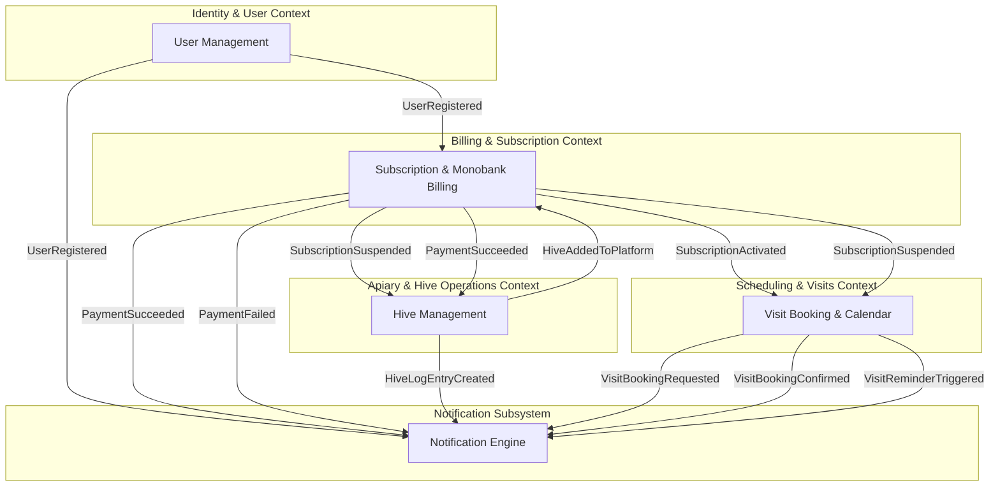

# Event Storming Lite & Bounded Context Map (BeLikeBee.app)

This document outlines the context boundaries, event-driven model (Domain Events), and architectural structure for the remote beekeeping SaaS platform **BeLikeBee.app**.

---

## 1. Event Storming Lite (14 Key Domain Events)

All events are stated in the past tense (_Domain Events_):

1. `UserRegistered` — A user registered in the system (as a Client or Beekeeper).
2. `HiveAddedToPlatform` — The beekeeper added a new physical hive to the apiary catalog.
3. `SubscriptionPlanSelected` — The client selected a subscription plan and a hive to rent.
4. `PaymentInvoiceCreated` — An invoice/receipt was generated for payment via Monobank.
5. `PaymentSucceeded` — The payment successfully went through and was confirmed via webhook.
6. `PaymentFailed` — The payment attempt failed.
7. `SubscriptionActivated` — The hive subscription was successfully activated/renewed.
8. `HiveLogEntryCreated` — The beekeeper logged an inspection/work update for a hive (photos, status, notes).
9. `VisitBookingRequested` — The client requested an online or offline visit to the apiary.
10. `VisitBookingConfirmed` — The beekeeper confirmed the slot for the visit.
11. `HoneyHarvestReserved` — The client reserved their final honey quota for the end of the season.
12. `NotificationSent` — A system notification (Push/Telegram) was sent to the user.
13. `SubscriptionSuspended` — The subscription was suspended after repeated failed payments.
14. `VisitReminderTriggered` — A confirmed visit starts soon and its reminder is due (published by a scheduled job).

---

## 2. Bounded Contexts & Ubiquitous Language

The system is divided into **5 Bounded Contexts** (4 core contexts plus the Notification Subsystem):

### 1. Identity & User Context

- **User** — An authenticated individual in the system.
- **Role** — System access level: `Client` (urban resident), `Beekeeper` (apiary owner), or `Admin` (platform operator).
- **Profile** — Personal details, notification preferences, and linked contact info.

### 2. Apiary & Hive Operations Context

- **Apiary** — Physical location hosting a group of hives, owned by a Beekeeper.
- **Digital Twin / Hive** — A specific physical hive assigned a QR code, history, and characteristics.
- **Hive Log** — A status report added by the beekeeper (frames, health checks, treatments).
- **Work Order** — A client's request for a specific task on their rented hive, which the beekeeper may accept or decline.

### 3. Billing & Subscription Context

- **Subscription** — A client's paid agreement on a chosen plan, renewed and charged each billing period.
- **Plan / Tariff** — Pricing tiers and service levels (e.g., _Basic_, _Premium + Honey_).
- **Invoice / Payment** — Financial transaction entities integrated with Monobank.
- **Honey Quota** — The weight of raw honey, set by the client's plan, guaranteed to the client at season end regardless of the hive's actual harvest.
- **Honey Reservation** — The client's confirmation near season end that they will take their honey quota.

### 4. Scheduling & Visits Context

- **Visit Slot** — An available time window for booking.
- **Visit Type** — `OnlineMasterclass` (live apiary stream) or `OfflineVisit` (in-person visit).
- **Booking** — A confirmed calendar reservation for a specific slot.

### 5. Notification Subsystem Context

- **Notification** — A message to one user, with its channel and delivery status.
- **Channel** — Delivery method: `Push` or `Telegram`.
- **Template** — The message text for each event type and locale.

---

## 3. Bounded Context Map (Mermaid Diagram)

Context interaction diagram via events (Event-Driven Integration):

---

## 4. Open Questions

- **Scheduled jobs**: `VisitReminderTriggered` needs something that runs on a timer (e.g., Vercel Cron, pg-boss). Not decided yet.
- **Booking cancellation**: there is no way to cancel or reschedule a booking, and no event for it.
- **Warning before suspension**: UC-4 notifies the client before a subscription is suspended, but no event triggers that message yet.
