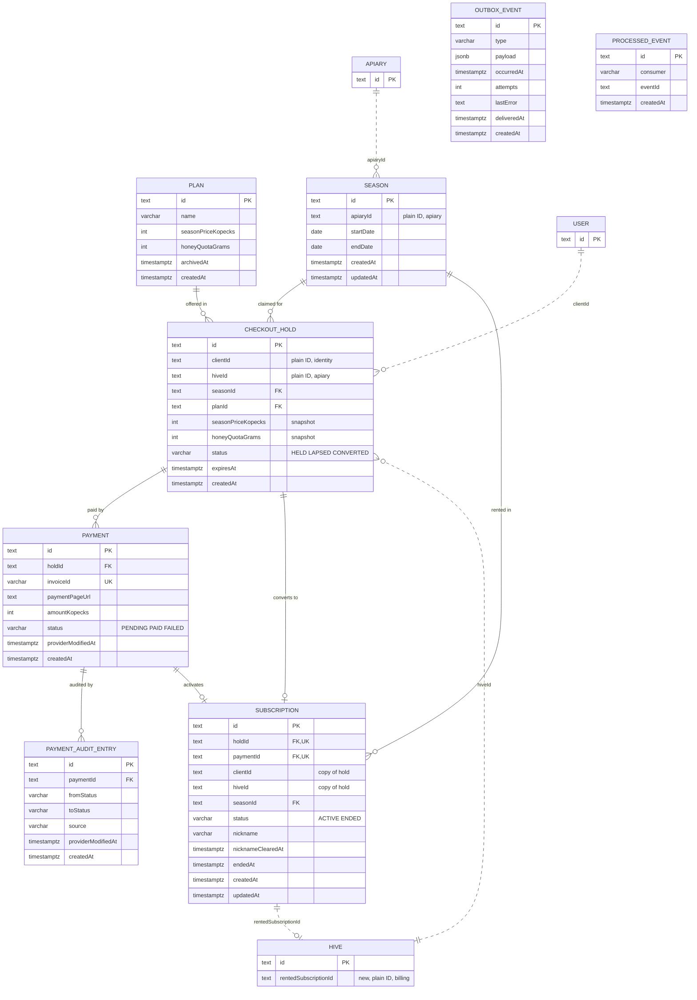

# Data model — hive-rental

<!-- Generated by generate-data-model. Migrations are STAGED under
docs/features/hive-rental/migrations/ (NOT the live migrations/ tree); implement-tasks promotes them. -->

Inputs: [PRD](./PRD.md) §4–§6, [sad.md](./sad.md) §5 (billing tables), §6 flows 1–14 and "Index hints", §8 (IDs, money, time, idempotency, audit), ADR-0004 to ADR-0007. Conventions: [`.claude/rules/migrations.md`](../../../.claude/rules/migrations.md) (project overrides first).

Conventions in one paragraph (decided 2026-10-30): table, column and constraint names follow Prisma and the existing schema (`"CheckoutHold"`, `"seasonId"`, `"Payment_invoiceId_key"`); IDs are `cuid()` `TEXT`; the "DB as dumb storage" rules hold: no `CHECK`, no trigger, no business `DEFAULT`, statuses are `VARCHAR(16)` validated in app code, `createdAt` only except where `updatedAt` is justified below, hard delete, `TIMESTAMPTZ(3)` for instants and `DATE` for Kyiv calendar dates. Money is integer kopecks, honey is integer grams. Foreign keys exist only inside one module; cross-module references (`apiaryId`, `hiveId`, `clientId`, `rentedSubscriptionId`) are plain IDs.

## ER diagram

Solid lines are foreign keys inside `billing`. Dotted lines are plain-ID references across modules (no foreign key). `OutboxEvent` and `ProcessedEvent` are shared infrastructure with no business relations.

## Aggregates

| Aggregate root | Owns | Module | Why |
|---|---|---|---|
| `Plan` | — | billing | Catalogue entry; terms immutable after insert (AC-04). Holds reference it, never change it. |
| `Season` | — | billing (ADR-0004) | One current or upcoming season per apiary; its dates lock once a hold or rental exists (AC-09). |
| `CheckoutHold` | `Payment` → `PaymentAuditEntry` | billing | The hold is the claim on a hive for a season (ADR-0006) and carries the plan-terms snapshot; every payment attempt belongs to one hold (flow 10), every payment state change to one payment. |
| `Subscription` | hive nickname | billing (ADR-0004) | The hive rental, created once from a converted hold and its paid payment. |
| `Hive` (existing) | rented mark | apiary | Event-driven copy only; display never reads it (ADR-0004, ADR-0007). |
| `OutboxEvent`, `ProcessedEvent` | — | `src/shared` infrastructure | No business meaning (ADR-0005). |

## Entities

### `Plan` (billing)

| Column | Type | Constraints | Notes |
|---|---|---|---|
| `id` | TEXT | PK, `cuid()` | |
| `name` | VARCHAR(100) | NOT NULL | 1–100 characters after trimming, the repo's name limit (PRD reference module); AC-02 empty check in Zod |
| `seasonPriceKopecks` | INTEGER | NOT NULL | Above zero (AC-02), checked in code. Admin enters hryvnias; stored as kopecks |
| `honeyQuotaGrams` | INTEGER | NOT NULL | Not below zero (AC-02), checked in code. Unit is grams (PRD says "weight"); the form may take kilograms |
| `archivedAt` | TIMESTAMPTZ(3) | NULL | NULL = on sale. Set once by archiving (AC-05); never cleared |
| `createdAt` | TIMESTAMPTZ(3) | NOT NULL DEFAULT CURRENT_TIMESTAMP | |

**Aggregate root:** root.
**Access patterns:** plans on sale in creation order (flow 4, 7) → `Plan_onSale_createdAt_idx`; plan by id → PK.
**Constraints:** no update path for the two terms columns exists in code (AC-04); no `updatedAt` because only `archivedAt` ever changes.

### `Season` (billing)

| Column | Type | Constraints | Notes |
|---|---|---|---|
| `id` | TEXT | PK, `cuid()` | |
| `apiaryId` | TEXT | NOT NULL | Plain ID into `apiary`; ownership checked through `apiary/index.ts` (flow 6) |
| `startDate` | DATE | NOT NULL | Kyiv calendar date, inclusive from 00:00 |
| `endDate` | DATE | NOT NULL | Kyiv calendar date, inclusive to 24:00. After `startDate`, not before today (AC-07): code |
| `createdAt` | TIMESTAMPTZ(3) | NOT NULL DEFAULT CURRENT_TIMESTAMP | |
| `updatedAt` | TIMESTAMPTZ(3) | NOT NULL | Prisma `@updatedAt`. **Opt-in, decided 2026-10-30:** dates change under AC-06b |

**Aggregate root:** root.
**Access patterns:** current or upcoming season of an apiary (`endDate >= today`) → `Season_apiaryId_endDate_idx`; seasons ended before today for the season-end job → `Season_endDate_idx`.
**Constraints:** "at most one current or upcoming season per apiary" (flow 6 postcondition) is enforced in code, under the lock described in [Concurrency notes](#concurrency-notes). A unique index cannot express it without a business-state column.

### `CheckoutHold` (billing)

| Column | Type | Constraints | Notes |
|---|---|---|---|
| `id` | TEXT | PK, `cuid()` | |
| `clientId` | TEXT | NOT NULL | Plain ID into `identity` |
| `hiveId` | TEXT | NOT NULL | Plain ID into `apiary`; existence checked through `apiary/index.ts` |
| `seasonId` | TEXT | NOT NULL, FK → `Season(id)` RESTRICT | |
| `planId` | TEXT | NOT NULL, FK → `Plan(id)` RESTRICT | The plan the client picked; read for its name |
| `seasonPriceKopecks` | INTEGER | NOT NULL | Plan-terms snapshot at hold start; the only source of the charged amount (PRD §6.1 price tampering) |
| `honeyQuotaGrams` | INTEGER | NOT NULL | Plan-terms snapshot at hold start (AC-05, AC-10) |
| `status` | VARCHAR(16) | NOT NULL | `HELD` → `LAPSED` (expired, set lazily in the checkout transaction) or `CONVERTED` (payment confirmed). `LAPSED` → `CONVERTED` for a late payment on a free hive (AC-19b). App-side union, no default |
| `expiresAt` | TIMESTAMPTZ(3) | NOT NULL | `createdAt + 15 min`; never moved by a retry (AC-18, QG-4) |
| `createdAt` | TIMESTAMPTZ(3) | NOT NULL DEFAULT CURRENT_TIMESTAMP | Hold start |

**Aggregate root:** root of `Payment` and `PaymentAuditEntry`.
**Access patterns:** live claim per hive and season (flow 7, 8) → `CheckoutHold_hiveId_seasonId_live_key`; client's held hold (AC-12, AC-13b) → `CheckoutHold_clientId_held_key`; held holds past expiry (lapse step, ADR-0006) → `CheckoutHold_held_expiresAt_idx`; live holds of a season (AC-09) → `CheckoutHold_seasonId_idx`.
**Constraints:** partial UNIQUE (`hiveId`, `seasonId`) where status is `HELD` or `CONVERTED`; partial UNIQUE (`clientId`) where status is `HELD`. A `CONVERTED` hold keeps counting as the hive's claim for that season, so a late activation (`LAPSED` → `CONVERTED`) fails on the same index when someone else holds or rents the hive. Read paths treat a `HELD` row with `expiresAt <= now()` as lapsed even before its status is updated.

### `Payment` (billing)

| Column | Type | Constraints | Notes |
|---|---|---|---|
| `id` | TEXT | PK, `cuid()` | |
| `holdId` | TEXT | NOT NULL, FK → `CheckoutHold(id)` RESTRICT | Many payments per hold (flow 10) |
| `invoiceId` | VARCHAR(64) | NOT NULL, UNIQUE | Monobank `invoiceId` <!-- TBD: confirm the maximum length against the Monobank docs in the first build slice --> |
| `paymentPageUrl` | TEXT | NOT NULL | Monobank `pageUrl`; lets the hold screen send the client back to the same invoice (AC-13b) |
| `amountKopecks` | INTEGER | NOT NULL | Copied from the hold's snapshot; what the invoice was created for |
| `status` | VARCHAR(16) | NOT NULL | `PENDING` → `PAID` or `FAILED`. Monobank `created`/`processing`/`hold` map to `PENDING`, `success` to `PAID`, `failure`/`expired` to `FAILED`. App-side union, no default |
| `providerModifiedAt` | TIMESTAMPTZ(3) | NULL | Monobank `modifiedDate` of the last applied change; apply-once skips a change that is not newer (sad §8 Idempotency) |
| `createdAt` | TIMESTAMPTZ(3) | NOT NULL DEFAULT CURRENT_TIMESTAMP | |

**Aggregate root:** `CheckoutHold`.
**Access patterns:** by invoice id (flow 9, flow 3) → `Payment_invoiceId_key`; a hold's latest payment (flow 10) → `Payment_holdId_createdAt_idx`; pending invoices for reconciliation (flow 3) → `Payment_pending_createdAt_idx`.
**Constraints:** a "payment without a hive rental" (AC-19b) is a `PAID` payment with no `Subscription` row. It is derived, not stored: the admin list is `PAID` payments left-anti-joined to `Subscription.paymentId`, served by `Subscription_paymentId_key`; the `PAID` side scans a table of hundreds of rows (sad §7). No `updatedAt`: every change is a `PaymentAuditEntry` row.

### `PaymentAuditEntry` (billing)

| Column | Type | Constraints | Notes |
|---|---|---|---|
| `id` | TEXT | PK, `cuid()` | |
| `paymentId` | TEXT | NOT NULL, FK → `Payment(id)` RESTRICT | |
| `fromStatus` | VARCHAR(16) | NULL | NULL on the entry that records creation |
| `toStatus` | VARCHAR(16) | NOT NULL | |
| `source` | VARCHAR(16) | NOT NULL | `CHECKOUT`, `RETRY`, `WEBHOOK`, `RECONCILE` |
| `providerModifiedAt` | TIMESTAMPTZ(3) | NULL | Provider time of the change, for the activation-delay measurement (PRD §6) |
| `createdAt` | TIMESTAMPTZ(3) | NOT NULL DEFAULT CURRENT_TIMESTAMP | Written in the state change's transaction |

**Aggregate root:** `CheckoutHold` (through `Payment`).
**Access patterns:** a payment's trail → `PaymentAuditEntry_paymentId_idx`.
**Constraints:** append-only. No raw webhook body is stored: Monobank's payload carries masked card data and SPEC §4 forbids storing card data.

### `Subscription` (billing) — the hive rental

| Column | Type | Constraints | Notes |
|---|---|---|---|
| `id` | TEXT | PK, `cuid()` | Carried in `PaymentSucceeded` and `SubscriptionEnded` |
| `holdId` | TEXT | NOT NULL, UNIQUE, FK → `CheckoutHold(id)` RESTRICT | Plan, plan-terms snapshot and season price come from the hold |
| `paymentId` | TEXT | NOT NULL, UNIQUE, FK → `Payment(id)` RESTRICT | The confirmed payment counted in season revenue (AC-24); UNIQUE makes a replayed confirmation unable to create a second rental (AC-16) |
| `clientId` | TEXT | NOT NULL | Copy of the hold's value (same module), for the client area and AC-12 |
| `hiveId` | TEXT | NOT NULL | Copy of the hold's value, for the public list |
| `seasonId` | TEXT | NOT NULL, FK → `Season(id)` RESTRICT | Copy of the hold's value, for revenue and season end |
| `status` | VARCHAR(16) | NOT NULL | `ACTIVE` → `ENDED` (season-end job, ADR-0007). Read paths also treat an `ACTIVE` rental past its season's end date as ended (AC-26) |
| `nickname` | VARCHAR(40) | NULL | Hive nickname, 1–40 characters after trimming (AC-21), plain text. NULL until set, or after clearing |
| `nicknameClearedAt` | TIMESTAMPTZ(3) | NULL | Moderation notice (AC-27): set when an admin or the owning beekeeper clears the nickname; reset to NULL when the client saves a new one |
| `endedAt` | TIMESTAMPTZ(3) | NULL | Set with `status = ENDED` |
| `createdAt` | TIMESTAMPTZ(3) | NOT NULL DEFAULT CURRENT_TIMESTAMP | Activation time |
| `updatedAt` | TIMESTAMPTZ(3) | NOT NULL | Prisma `@updatedAt`. **Opt-in, decided 2026-10-30:** nickname and status change |

**Aggregate root:** root (created from a `CheckoutHold`).
**Access patterns:** active rental and nickname per hive (flow 7, 14) → `Subscription_hiveId_idx`; client's rentals (client area, AC-12) → `Subscription_clientId_idx`; rentals and revenue of a season (flow 12), rental check for AC-09, season-end job (flow 13) → `Subscription_seasonId_idx`.
**Constraints:** UNIQUE `holdId`, UNIQUE `paymentId`. Exclusivity per hive and season comes from the hold's partial unique index, because every subscription has exactly one `CONVERTED` hold.

### `Hive` (apiary, existing table) — rented mark

| Column | Type | Constraints | Notes |
|---|---|---|---|
| `rentedSubscriptionId` | TEXT | NULL | **New.** Set to the event's subscription id on `PaymentSucceeded`; cleared on `SubscriptionEnded` or `SubscriptionSuspended` only when it still equals that event's subscription id, so a late end event never clears the next season's mark. Plain ID, no FK |

Written by primary key only; no index. `apiary` still does not read payment or subscription state (`.claude/rules/apiary.md`); it stores the id from the event payload.

### `OutboxEvent` (`src/shared`, ADR-0005)

| Column | Type | Constraints | Notes |
|---|---|---|---|
| `id` | TEXT | PK, `cuid()` | The event id that consumers record |
| `type` | VARCHAR(64) | NOT NULL | `DomainEvent["type"]` |
| `payload` | JSONB | NOT NULL | Opaque event payload: its shape is the contract in `src/shared/events`, not a table schema |
| `occurredAt` | TIMESTAMPTZ(3) | NOT NULL | |
| `attempts` | INTEGER | NOT NULL | Set to 0 by `publish()`, no DB default; alert after 5 (sad flows 9, 13) |
| `lastError` | TEXT | NULL | Last handler error message |
| `deliveredAt` | TIMESTAMPTZ(3) | NULL | NULL = pending |
| `createdAt` | TIMESTAMPTZ(3) | NOT NULL DEFAULT CURRENT_TIMESTAMP | |

**Access patterns:** pending events oldest first (dispatcher, sweep) → `OutboxEvent_pending_createdAt_idx`.

### `ProcessedEvent` (`src/shared`, ADR-0005)

| Column | Type | Constraints | Notes |
|---|---|---|---|
| `id` | TEXT | PK, `cuid()` | |
| `consumer` | VARCHAR(64) | NOT NULL | Handler name, e.g. `apiary.markHiveRented` |
| `eventId` | TEXT | NOT NULL | `OutboxEvent.id`, no FK, so outbox rows can be pruned later |
| `createdAt` | TIMESTAMPTZ(3) | NOT NULL DEFAULT CURRENT_TIMESTAMP | |

**Access patterns:** has this consumer handled this event (every handler) → `ProcessedEvent_consumer_eventId_key`.
**Constraints:** UNIQUE (`consumer`, `eventId`); the handler inserts it in the same transaction as its effect.

## Indexes

Partial indexes (marked †) are hand-written SQL that Prisma cannot declare; keep them when Prisma generates later migrations (sad §11).

| Index | Columns | Query it serves |
|---|---|---|
| `Plan_onSale_createdAt_idx` † | `Plan(createdAt) WHERE archivedAt IS NULL` | Catalogue of plans on sale on every hive page and the admin list (flows 4, 5, 7) |
| `Season_apiaryId_endDate_idx` | `Season(apiaryId, endDate)` | Current or upcoming season of an apiary: set season (flow 6), hive page (flow 7), beekeeper area (flow 12), checkout (flow 8) |
| `Season_endDate_idx` | `Season(endDate)` | Season-end job: seasons that ended before today in Kyiv time (flow 13) |
| `CheckoutHold_hiveId_seasonId_live_key` † | UNIQUE `CheckoutHold(hiveId, seasonId) WHERE status IN ('HELD','CONVERTED')` | ADR-0006 exclusivity (AC-13, QG-1); live hold per hive on the hive page (flow 7); late activation guard (AC-19b) |
| `CheckoutHold_clientId_held_key` † | UNIQUE `CheckoutHold(clientId) WHERE status = 'HELD'` | One held hold per client (AC-12, ADR-0006); return to own hold (AC-13b) |
| `CheckoutHold_held_expiresAt_idx` † | `CheckoutHold(expiresAt) WHERE status = 'HELD'` | Lapse expired holds at the start of the checkout transaction (ADR-0006) |
| `CheckoutHold_seasonId_idx` | `CheckoutHold(seasonId)` | FK; does a season have a live hold (AC-09, flow 6) |
| `CheckoutHold_planId_idx` | `CheckoutHold(planId)` | FK (self-check rule) |
| `Payment_invoiceId_key` | UNIQUE `Payment(invoiceId)` | Webhook and reconciliation lookup (flows 9, 3) |
| `Payment_holdId_createdAt_idx` | `Payment(holdId, createdAt)` | FK; latest payment of a hold on the hold screen (flow 10) |
| `Payment_pending_createdAt_idx` † | `Payment(createdAt) WHERE status = 'PENDING'` | Reconciliation of invoices still pending (flow 3) |
| `PaymentAuditEntry_paymentId_idx` | `PaymentAuditEntry(paymentId)` | FK; a payment's audit trail (PRD §6 activation-delay measurement) |
| `Subscription_holdId_key` | UNIQUE `Subscription(holdId)` | FK; one rental per hold |
| `Subscription_paymentId_key` | UNIQUE `Subscription(paymentId)` | FK; AC-16 replay safety; anti-join for payments without a hive rental (AC-19b admin list) |
| `Subscription_hiveId_idx` | `Subscription(hiveId)` | Rented badge and nickname per hive (flow 7), nickname clearing (flow 14) |
| `Subscription_clientId_idx` | `Subscription(clientId)` | Client area; AC-12 overlapping-season check (flow 8) |
| `Subscription_seasonId_idx` | `Subscription(seasonId)` | FK; season revenue (flow 12), AC-09, season-end job (flow 13) |
| `OutboxEvent_pending_createdAt_idx` † | `OutboxEvent(createdAt) WHERE deliveredAt IS NULL` | Dispatch after response and the daily sweep (ADR-0005, flows 2, 9, 13) |
| `ProcessedEvent_consumer_eventId_key` | UNIQUE `ProcessedEvent(consumer, eventId)` | Idempotent handlers (ADR-0005) |

## Concurrency notes

These need no schema beyond the indexes above, but implement-tasks must follow them:

- **Checkout start (flow 8):** one transaction: `pg_advisory_xact_lock` on the client id (ADR-0006, AC-12); `SELECT … FOR UPDATE` on the hive's `Season` row; lapse `HELD` holds past `expiresAt`; insert the hold. A unique violation on `CheckoutHold_hiveId_seasonId_live_key` maps to "someone else is paying" (AC-13); on `CheckoutHold_clientId_held_key` to "one hive at a time" (AC-12).
- **Season change (flow 6, AC-09):** lock the same `Season` row `FOR UPDATE` before checking live holds and rentals, so a checkout cannot slip in between. Creating the first season of an apiary has no row to lock: take `pg_advisory_xact_lock` on the apiary id. This settles the "season lock vs checkout start" item sad §6 flagged for an ADR-0006 amendment.
- **Activation (flows 9, 3):** one transaction: payment `PAID` + audit entry, hold `CONVERTED`, `Subscription` insert, `OutboxEvent` `PaymentSucceeded`. If the hold is `LAPSED` and the update to `CONVERTED` hits the live-claim index, or AC-12 forbids it, roll back to a savepoint and record the payment `PAID` without a subscription (AC-19b).

## Prisma models (sketch for implement-tasks)

`src/modules/billing/billing.prisma` and `src/shared/db/outbox.prisma` must produce exactly the staged SQL, so `prisma migrate dev` sees no drift. Type mapping: `String @db.VarChar(n)`, `DateTime @db.Timestamptz(3)`, `DateTime @db.Date`, `Json`. Relations only inside `billing`, with `onDelete: Restrict`. The † indexes are not declared in Prisma; add a schema comment next to each model naming them.

## Test fixtures

The repo keeps test data helpers inside each `*.int.test.ts` (`src/modules/apiary/apiary.int.test.ts`: `signInAs`, `createApiary`), not in a fixtures folder. No fixture code is generated now: the Prisma models do not exist yet, so it would not compile. implement-tasks adds these helpers to `src/modules/billing/*.int.test.ts`:

- `createPlan({ seasonPriceKopecks?, honeyQuotaGrams?, archived? })` — a plan named `Test Plan`.
- `createSeason({ apiaryId, startDate?, endDate? })` — defaults to an upcoming season in Kyiv dates.
- `startHold({ clientId, hiveId, seasonId, planId, expiresAt? })` — a `HELD` hold with the plan's snapshot.
- `signedWebhook(body)` — a Monobank-shaped body signed with a test key pair generated in the test, never a real key.
- PII guard: clients are `client-<cuid>@example.test` / `Test User`; nicknames are `Test Hive`.

## Seeds

None. Plans are created by the admin (US-01) or, if US-01 is cut, by a one-off script, not a migration. No lookup tables: statuses are app-side unions.
