# Software Architecture Document — hive-rental

<!-- Stages 04-05 → see sdlc/plugin/skills/architecture-design/SKILL.md -->
<!-- 12 Arc42 sections. Empty sections — <!-- N/A: <one-line reason> -->. -->
<!-- C4 Context (L1) lives inline in §3. C4 Container (L2) lives inline in §5. -->
<!-- §6 Runtime view seeds the primary flow(s) here; complete-sequence-diagrams (stage 06) then -->
<!--    fills §6 with every critical flow / §5 AC — no cap. -->
<!-- Numbers in §10 come VERBATIM from PRD §6 NFR — no inventing, no rounding. -->

## 1. Introduction and goals

**Intent.** hive-rental lets a client rent one specific hive for one apiary season, pay for it once online through Monobank acquiring (test mode only), and give the hive a hive nickname. A beekeeper sets the season dates of each apiary and sees which hives are rented and the apiary's season revenue; an admin curates the plan catalogue. It is the core flow later features build on (hive feed, visits, honey reservation), and it is built inside the existing modular monolith: it is the first code in the `billing` module (PRD §1, §2).

**Top-3 quality goals (1-liners; full scenarios in §10):**

1. **Payment correctness and exclusivity**: 0 duplicate rentals and 0 double-counted payments on repeated confirmations, 0 hives with more than one active rental or checkout hold under 10 concurrent attempts, 100% of payment state changes audited.
2. **Activation reliability**: payment confirmation received → hive rental active and visible ≤ 60 s p95, including when marking the hive rented in its apiary fails (AC-17).
3. **Responsiveness**: p95 ≤ 500 ms for the hive page with plans and the public hive list; p95 ≤ 2 s from a confirmed plan to the client being on the payment page.

**Stakeholders.**

| Role | Interest | Sign-off owner? |
|---|---|---|
| client | Rents and pays for one hive per season, names it, sees the hive rental in their own area | No |
| beekeeper | Sets season dates per apiary; sees rented hives, hive nicknames, client display names and season revenue | No |
| admin | Creates and archives plans; clears offensive hive nicknames; settles payments without a hive rental (AC-19b) outside the product | No |
| visitor | Browses the public hive list and sees the "rented" badge and hive nickname, never a client's personal data | No |
| Architect / Tech Lead (ivan lysakov) | SAD and ADR approval | Yes |
| PM (ivan lysakov) | Consulted on §10 quality goals and §11 risk severities | No |

<!-- Decision overrides (¶4) — populated by the Step-7 critic resolution loop, empty otherwise.       -->
<!-- Each: «Decision override: <headline> — rationale: <reason>» so downstream skills see the choice.  -->

## 2. Constraints

**Technical.**
- TypeScript `^7.0.2`; Next.js `^16.4.2` (App Router), React `^19.3.1` (`package.json`).
- Prisma `7.10.1` with `@prisma/adapter-pg`, multi-file schema (`prisma.config.ts` → `src`, generator in `src/shared/db/schema.prisma`); PostgreSQL 17 (`postgres:17` in `.devcontainer/docker-compose.yaml`); migrations in `src/shared/db/migrations/`.
- NextAuth `^4.24.15` (Credentials provider, JWT sessions carrying `id` and `role`); Zod `^4.6.7` for all external input (forms, webhooks, env); next-intl `4.14.9` (uk and en); Tailwind `^4.3.3` + shadcn/ui; Vitest `^5.0.5` (unit + integration on `belikebee_test`), `@playwright/test` `^1.64.1`; pnpm `10.28.0`.
- Feature-first modular monolith (ADR 0001 (initial setup), `ARCHITECTURE.md`): cross-module calls only through `src/modules/<name>/index.ts` or domain events in `src/shared/events/`; each Prisma model is owned by one module.
- Monobank acquiring is the only payment gateway, called only from `billing` (ADR 0001 (initial setup) §4, `.claude/rules/billing.md`).
- The existing event bus (`src/shared/event-bus.ts`) is in-process and not durable; ADR 0001 (initial setup) requires a durable path for payment events before going live. No subscriber is wired yet.
- IDs are `cuid()` strings; money is integer kopecks end to end (`.claude/rules/billing.md`); no scheduler or background-job infrastructure exists.
- **Hosting: Vercel, for now** (serverless functions, no long-running process; matches the existing `@vercel/blob` photo storage). Cloudflare Workers (via OpenNext) was considered and may replace it, so the background-job trigger is kept replaceable → [ADR-0001](adr/0001-host-on-vercel-for-v1.md), §11.

**Organisational.**
- One developer (ivan lysakov), who is also Architect, Tech Lead and PM.
- Deadline: the capstone defence date, not yet known (PRD §8, due before `/sdlc:break-tasks`) → §11.
- Cut order if time runs short: US-10 (nickname moderation; admin clears by one-off script), then US-01 (plans created by script) (PRD §1).

**Conventions.**
- `CLAUDE.md`, `ARCHITECTURE.md`, `.claude/rules/billing.md`, `.claude/rules/apiary.md`.
- Module files are flat: `*.action.ts` (server actions), query modules, `*.schema.ts` (Zod), `access.ts`, `ui/`, `messages/{uk,en}.json`, `*.test.ts` / `*.int.test.ts`.
- Errors are returned as result unions, not thrown (`src/modules/apiary/add-hive.action.ts`); something another beekeeper owns answers exactly like something missing (`src/modules/apiary/apiaries.ts`).
- Cross-module references are plain IDs with no Prisma relation; migrations are named `YYYYMMDDHHMMSS_<module>_<description>`.

**Regulatory / external.**
- Payments in Monobank test mode only; no real money in v1 (PRD §3).
- No card data stored by the platform (SPEC §4); amounts and statuses are confidential.
- Every Monobank webhook is verified before processing: ECDSA over the raw body (`X-Sign`) with the key from `GET /api/merchant/pubkey`; no shared secret (CLAUDE.md, ADR 0001 (initial setup)).
- Personal data is confidential: a hive rental links a named person to a payment and a place; the client's display name is shown only to the owning beekeeper; the hive nickname is public plain text (PRD §6.1).
- Security review required before release (PRD §6.1). Timestamps stored in UTC, shown and season-bounded in Europe/Kyiv; currency UAH (SPEC §4, PRD §1).

## 3. Context and scope

BeLikeBee already lists admin-verified beekeepers' hives publicly; hive-rental adds the money path. A client picks a season plan on an available hive, the hive is held for 15 minutes while they pay through Monobank, and Monobank's confirmation turns the hold into a hive rental that the client names and the public list shows as rented. Beekeepers set season dates and watch confirmed season revenue; the admin curates the plan catalogue (PRD §1, SPEC UC-1).

**External systems (in / out):**

| Actor or system | Type | Interaction |
|---|---|---|
| client | Person | Chooses a plan on a hive page, pays, sees the hive rental in their own area, sets the hive nickname |
| beekeeper | Person | Sets apiary season dates; sees rented hives and season revenue; clears a hive nickname on own hives |
| admin | Person | Creates and archives plans; clears hive nicknames; sees payments without a hive rental (AC-19b) |
| visitor | Person | Browses the public hive list and hive pages ("rented" badge, hive nickname) |
| Monobank acquiring | System (external) | Out: create invoice, read invoice status, fetch the webhook public key. In: payment status webhooks, untrusted until `X-Sign` is verified |
| Scheduler (Vercel Cron, per ADR-0001) | System (external) | In: calls protected job endpoints on a schedule, untrusted until its secret is checked |

Trust boundary: everything that arrives from Monobank or the scheduler is verified before the system acts on it; client input never sets an amount (PRD §6.1, price tampering).

**C4 Context (L1):**

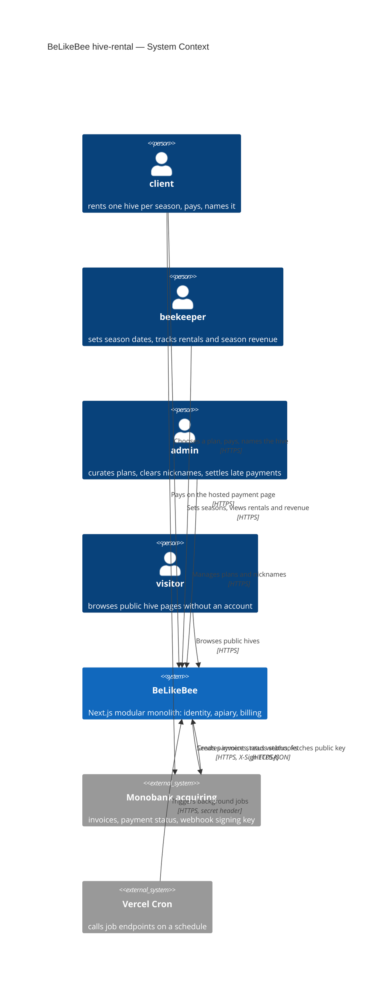

## 4. Solution strategy

**Target surface(s) (the first decision — what's being built):** `[backend-service, web-frontend, worker]` → [ADR-0002](adr/0002-build-backend-web-and-worker-surfaces.md)

- `backend-service`: `billing` module logic (plans, seasons, checkout holds, subscriptions = hive rentals, payments, audit), server actions for every command, and the Monobank webhook route handler, all inside the existing Next.js deploy.
- `web-frontend`: hive page with plans, checkout-hold screen, client area (hive rental, hive nickname), beekeeper area (season dates, rentals, season revenue), admin plan catalogue and nickname clearing, "rented" badge on the public list. Built from the existing shadcn/ui primitives (`src/shared/ui`) and the tokens in `src/app/globals.css`.
- `worker`: scheduled route handlers called by Vercel Cron: outbox sweep (re-dispatch undelivered events), Monobank invoice reconciliation (missed webhooks), season-end job. Same deploy, no new server.

**Top strategic choices (the seeds for ADRs):**

1. **UI-architecture (web-frontend): server-rendered pages + server actions + two client islands** → [ADR-0003](adr/0003-render-rental-ui-on-server-with-client-islands.md). Pages stay React Server Components and commands go through server actions, as in `apiary`. Only the hold countdown and the payment-status block are `"use client"`; the status block calls `router.refresh()` every few seconds until the payment status is final. Serves QG-3 (p95 ≤ 500 ms) and WCAG 2.1 AA with little browser JS; no JSON API is written for the UI.
2. **`billing` owns seasons, checkout holds, subscriptions (hive rentals), hive nicknames, plans and payments** → [ADR-0004](adr/0004-billing-owns-seasons-holds-and-hive-rentals.md). Closes PRD §8 "which context owns season dates". `billing` is the source of truth for whether a hive is available, awaiting payment or rented; `src/app` pages compose `apiary`'s public hive data with `billing`'s rental status. `billing` checks apiary ownership through `apiary/index.ts`. `apiary` keeps only its own rented mark, set and cleared by events, and never reads payment state (`.claude/rules/apiary.md`). Serves QG-1 and QG-2: exclusivity and the badge never depend on the apiary mark (AC-17).
3. **Domain events go through a transactional outbox** → [ADR-0005](adr/0005-deliver-domain-events-through-transactional-outbox.md). Publishing writes an `OutboxEvent` row in the same database transaction as the state change; after the response (`after()`), a dispatcher hands pending rows to subscribers; the worker's sweep re-dispatches anything left. Delivery is at-least-once, so every handler is idempotent (a processed-event record per consumer). Closes the ADR 0001 (initial setup) risk of losing payment events and answers PRD §8 "how the apiary's rented mark catches up": at the next dispatch, which is a checkout-hold screen refresh or the daily sweep (§7), so up to a day after a failed handler. The 60 s target applies to activation and visibility, which read `billing`, never the mark. Serves QG-2.
4. **Hive exclusivity is enforced by the database** → [ADR-0006](adr/0006-enforce-hive-exclusivity-with-partial-unique-indexes.md). One transaction per checkout start: lapse expired holds, then insert the new hold. Partial unique indexes (unique only over rows in a given status) allow one live claim (held or active) per hive and season and one held hold per client; AC-12's overlapping-season rule runs under a per-client transaction-scoped advisory lock (`pg_advisory_xact_lock`). A second concurrent insert fails in Postgres, and client B is told someone else is paying. Serves QG-1 (10 concurrent attempts → 0 double claims).
5. **Season end is a new `SubscriptionEnded` event** → [ADR-0007](adr/0007-end-hive-rentals-with-subscription-ended-event.md). Closes PRD §8 "which signal clears the rented state at season end". Read-side status is computed from the season end date in Europe/Kyiv, so AC-26 holds at 00:00 without waiting for a job. A daily worker job then marks ended subscriptions `ENDED` and publishes `SubscriptionEnded` through the outbox, and `apiary` clears its mark on it. This needs an amendment to `.claude/rules/apiary.md` (clear on `SubscriptionSuspended` or `SubscriptionEnded`), `docs/bc-map.md` and `src/shared/events/`.

Inline (below the ADR threshold): a hold lapses by time (`expiresAt` compared at read and write), with no job; checkout holds snapshot the plan's season price and honey quota when they start (AC-05, AC-10, price tampering); the Monobank invoice is created with a lifetime equal to the hold's remaining time (PRD §8 open question, first build slice); each refresh of the checkout-hold screen's status island (ADR-0003) also dispatches pending outbox events (ADR-0005) and, if no webhook arrived about 20 s after payment started, reconciles that hold's invoice with Monobank (§6 flow 3, §7).

Each tactical decision in later sections should be traceable to one of these strategic seeds. Tactical decisions that *contradict* a strategic choice are red flags — surface them in §11 Risks.

## 5. Building block view

The feature stays inside the feature-first modular monolith (ADR 0001 initial setup): `billing` gets its first code and owns every new table (ADR-0004); `apiary` gains a rented mark and event handlers; `identity` is only read through `getSession`. Modules talk through `index.ts` calls (reads: ownership, public hive data, display names) and through outbox-backed domain events (state changes: `PaymentSucceeded`, `SubscriptionEnded`). Files follow the repo's flat module convention (`*.action.ts`, query modules, `*.schema.ts`, `access.ts`, `ui/`, `messages/`), with the Monobank adapter in its own folder behind a gateway interface (ADR 0001 initial setup §4).

**Internal decomposition:**

```
src/modules/billing/
├── billing.prisma            Plan, Season, CheckoutHold, Subscription (hive rental + hive nickname), Payment, PaymentAuditEntry
├── index.ts                  public API: server actions, read models, UI, event handlers, job entry points, messages
├── access.ts                 currentClient / currentAdmin (role checks over identity.getSession)
├── plans.ts                  plan catalogue queries
├── create-plan.action.ts     archive-plan.action.ts      plan.schema.ts
├── seasons.ts                set-season.action.ts        season.schema.ts   (ownership via apiary/index.ts)
├── checkout.ts               start-checkout.action.ts    (hold transaction, ADR-0006; invoice creation)
├── payments.ts               apply a Monobank status change once, audit it, activate or record "paid without a hive rental" (AC-19b)
├── webhook.ts                handleMonobankWebhook: X-Sign check on the raw body, then payments.ts
├── rentals.ts                read models: hive rental status per hive, client's rental, beekeeper season revenue
├── set-nickname.action.ts    clear-nickname.action.ts    nickname.schema.ts
├── jobs.ts                   reconcilePayments, endFinishedSeasons
├── monobank/
│   ├── gateway.ts            PaymentGateway interface
│   └── monobank-gateway.ts   invoice create / status / pubkey + ECDSA verify
├── ui/                       plan picker, hold screen islands, client rental card, season form, revenue table, admin plans
└── messages/{uk,en}.json

src/modules/apiary/           + rented mark on Hive; rental-events.ts (PaymentSucceeded → mark, SubscriptionEnded / SubscriptionSuspended → clear)
src/shared/db/outbox.prisma   OutboxEvent, ProcessedEvent (infrastructure, no business meaning)
src/shared/event-bus.ts       publish(tx, event) writes OutboxEvent; dispatchPending() delivers to subscribers
src/shared/events/index.ts    + PaymentSucceeded, PaymentFailed, SubscriptionActivated, SubscriptionEnded, …
src/app/event-subscriptions.ts  wires module handlers to event types (src/shared cannot import modules)
src/app/api/billing/monobank/webhook/route.ts   thin: raw body → billing.handleMonobankWebhook
src/app/api/jobs/{outbox,reconcile-payments,season-end}/route.ts   thin, cron-secret checked
src/app/…                     hive page with plans, checkout hold page, client area, beekeeper area, admin plans
```

**C4 Container (L2):**

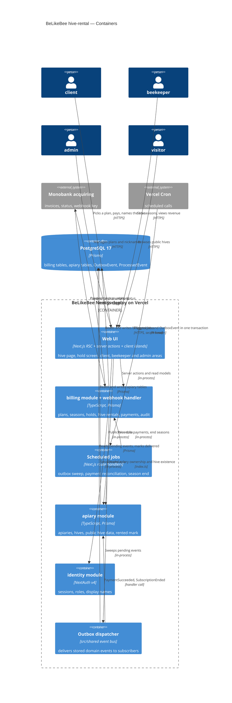

## 6. Runtime view

Participants are the §5 containers. Messages are semantic; endpoint-level detail arrives with api-forge. complete-sequence-diagrams (stage 06) extends this section to every critical flow and §5 acceptance criterion.

**Critical flow 1: checkout hold, payment and activation (AC-10, AC-15, AC-16, AC-17)**

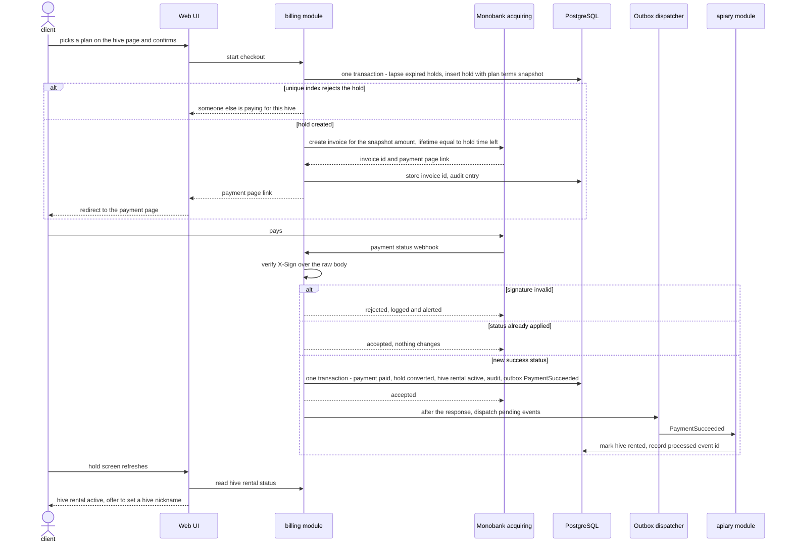

**Critical flow 2: apiary update fails and catches up (AC-17)**

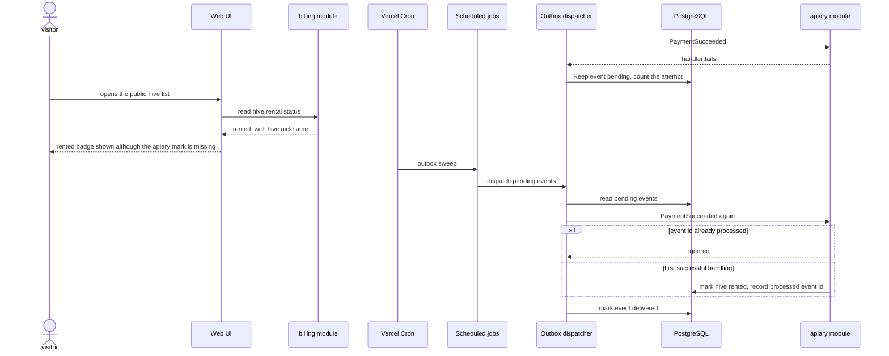

**Critical flow 3: missed or late payment confirmation (SPEC §4 recovery, AC-19, AC-19b)**

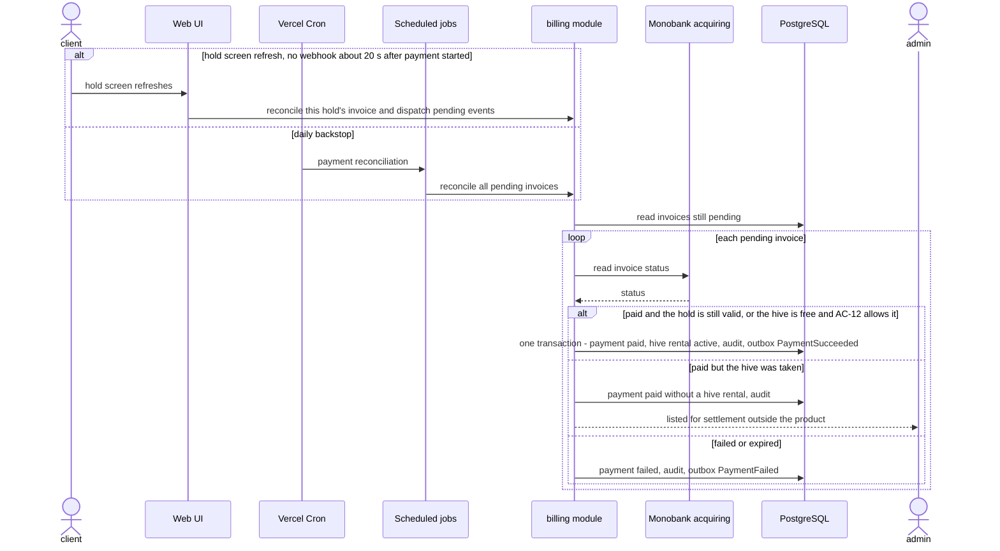

The same apply-once logic runs for a webhook that arrives after its hold lapsed, so a late confirmation and a reconciled one end in the same state.

Flows 4–14 below cover every PRD §4 user story and §5 acceptance criterion, in user-story order. They use generic participants, each qualified by its domain role: `<service> rentals` owns plans, seasons, checkout holds, hive rentals and payments (ADR-0004); `<service> hives` owns apiaries, hives and the rented mark; `<service> accounts` owns sessions and display names; `<message-bus> outbox` delivers domain events (ADR-0005); `<external-system> payment provider` is the acquirer. Participant names are written as `#lt;…#gt;` because Mermaid strips a literal `<…>` as an HTML tag when it renders.

### Flow 4: Create a plan (US-01: AC-01, AC-02, AC-03)

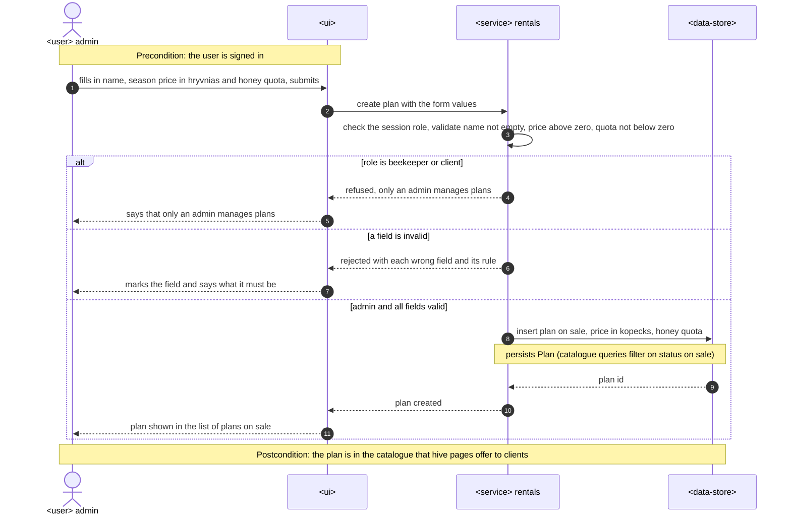

### Flow 5: Archive a plan, plan terms stay fixed (US-01: AC-04, AC-05, AC-03)

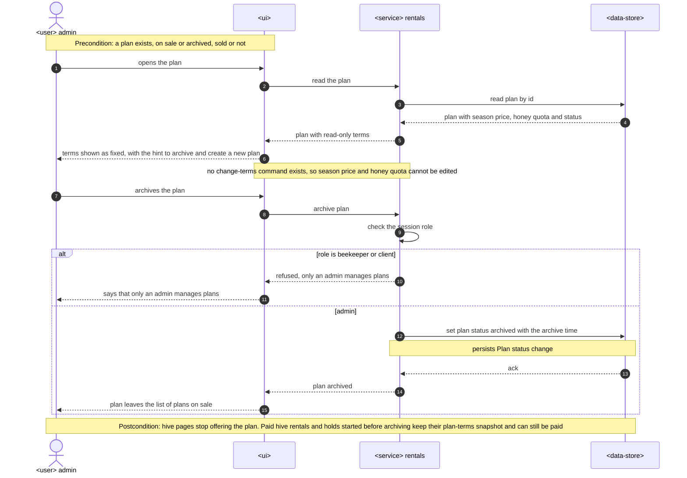

### Flow 6: Set or change apiary season dates (US-02: AC-06, AC-06b, AC-07, AC-08, AC-09)

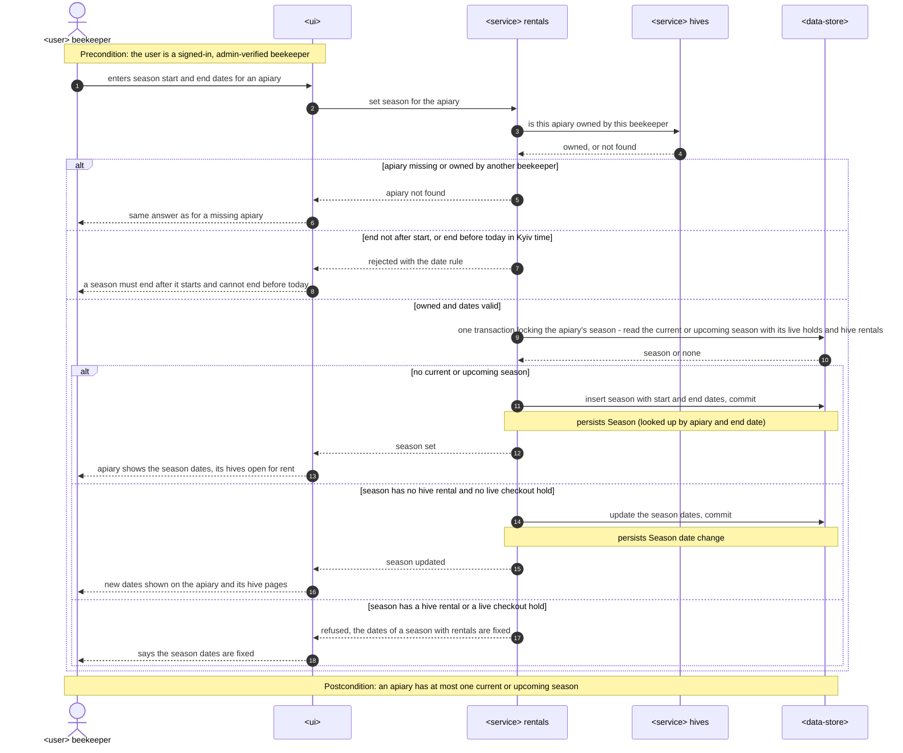

### Flow 7: Hive page and public hive list (US-03, US-07, US-09: AC-10, AC-11, AC-23, AC-26)

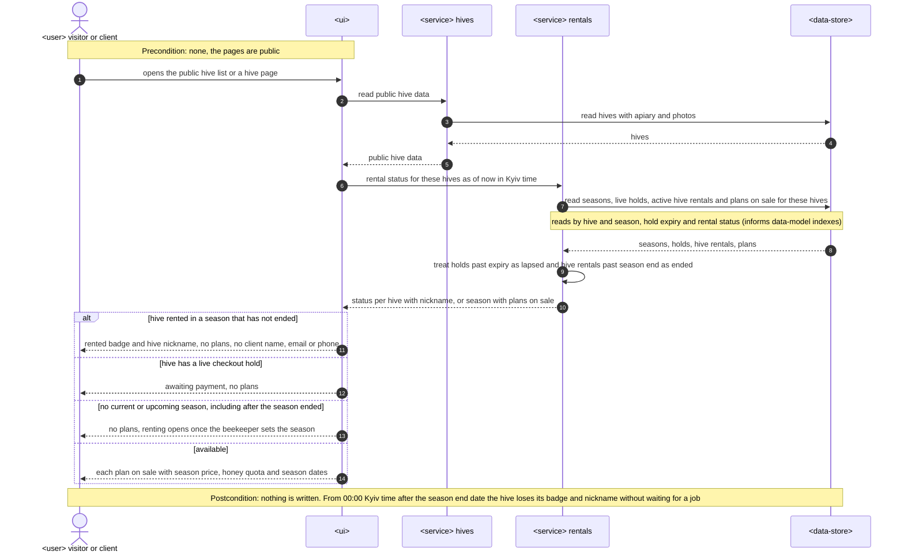

### Flow 8: Start a checkout hold (US-03: AC-10, AC-12, AC-13, AC-13b, AC-14, AC-05)

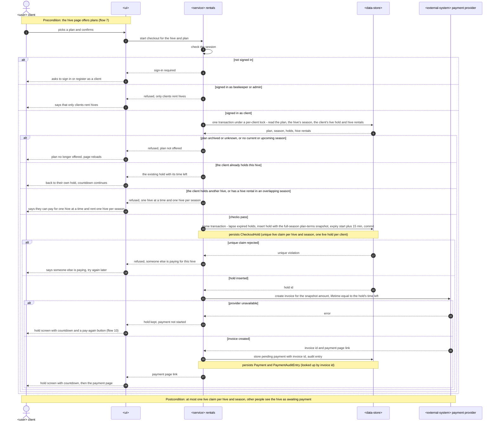

### Flow 9: Payment status callback (US-04: AC-15, AC-16, AC-17, AC-18, AC-19b)

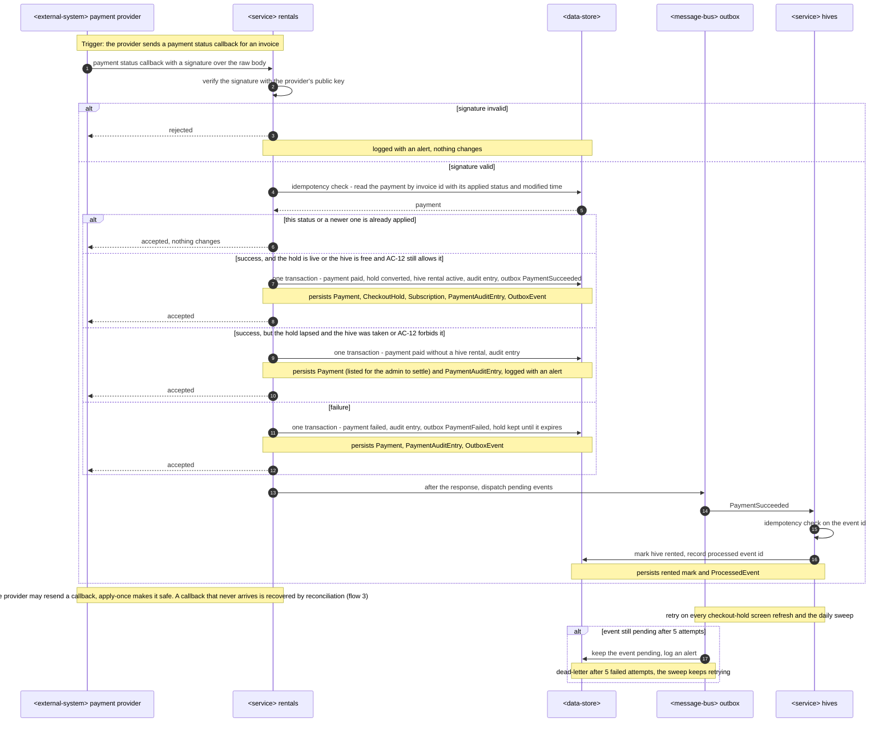

### Flow 10: Payment failed, retry within the hold, hold lapses (US-05: AC-18, AC-19, AC-19b)

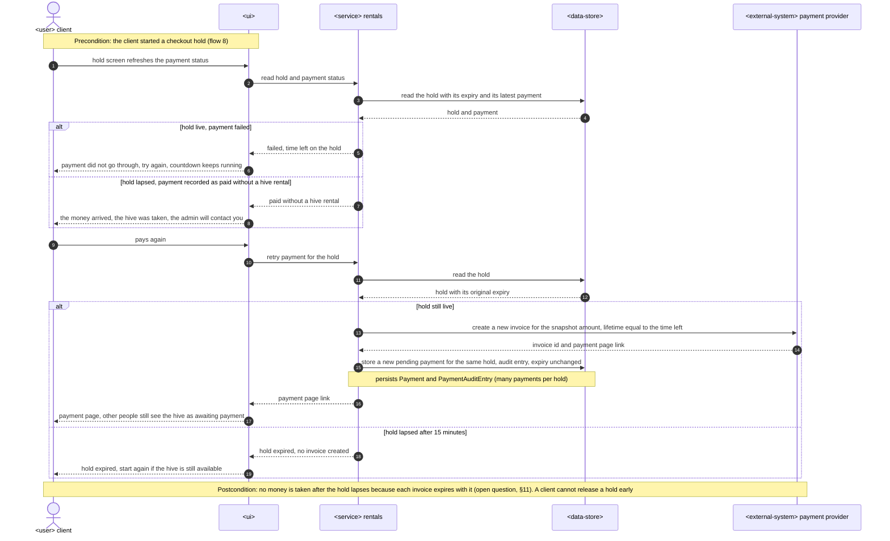

### Flow 11: Set a hive nickname (US-06: AC-20, AC-21, AC-22)

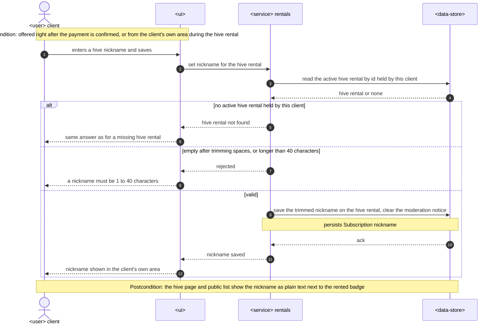

### Flow 12: Beekeeper sees hive rentals and season revenue (US-08: AC-24, AC-25)

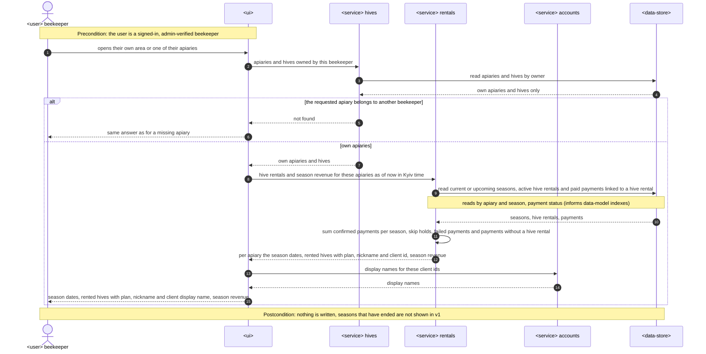

### Flow 13: Season end job (US-09: AC-26)

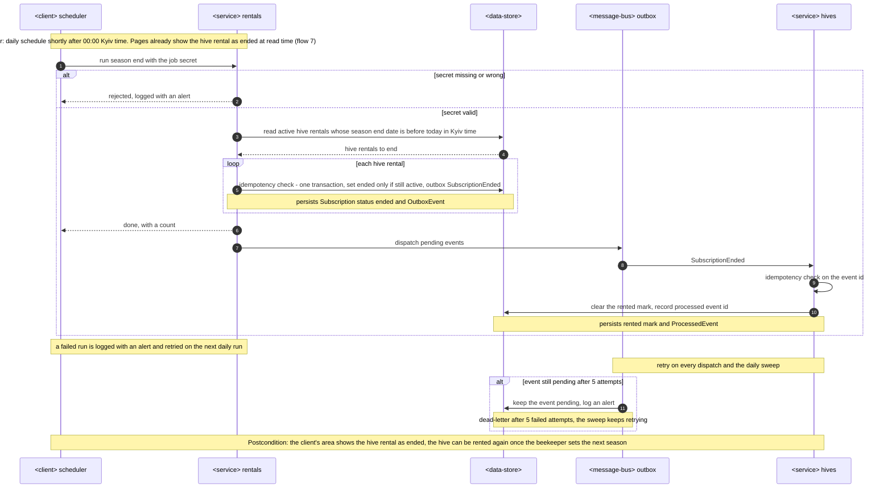

### Flow 14: Clear an offensive hive nickname (US-10: AC-27, AC-28)

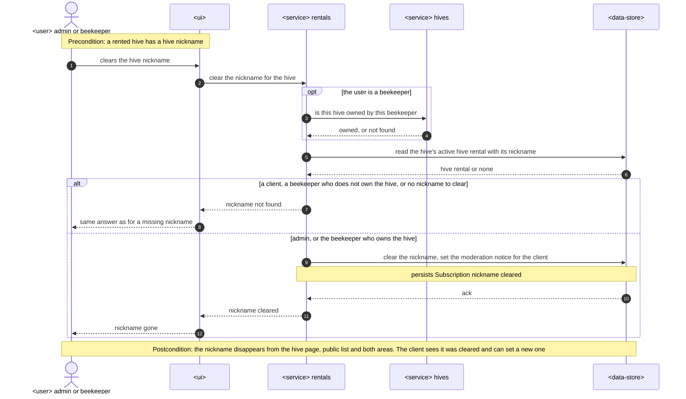

### Coverage: user stories and acceptance criteria → flows

| User story | Flows |
|---|---|
| US-01 Create and archive plans | 4, 5 |
| US-02 Set apiary season dates | 6 |
| US-03 Choose a plan for a hive | 7, 8 (and 1) |
| US-04 Pay for a hive rental | 9 (and 1, 2) |
| US-05 Retry a failed payment | 10 (and 3) |
| US-06 Name my rented hive | 11 |
| US-07 See which hives are rented | 7 |
| US-08 Track rentals and season revenue | 12 |
| US-09 Free hives after season end | 13, 7 |
| US-10 Clear an offensive nickname | 14 |

| AC | Where it is shown |
|---|---|
| AC-01 | Flow 4, happy path |
| AC-02 | Flow 4, `else a field is invalid` |
| AC-03 | Flow 4 and flow 5, `alt role is beekeeper or client` |
| AC-04 | Flow 5, read-only terms and the "no change-terms command" note |
| AC-05 | Flow 5 postcondition; flow 8, `alt plan archived or unknown` |
| AC-06 | Flow 6, `alt no current or upcoming season` |
| AC-06b | Flow 6, `else season has no hive rental and no live checkout hold` |
| AC-07 | Flow 6, `else end not after start, or end before today` |
| AC-08 | Flow 6, `alt apiary missing or owned by another beekeeper` |
| AC-09 | Flow 6, `else season has a hive rental or a live checkout hold` |
| AC-10 | Flow 7, `else available`; flow 8, `else checks pass`; flow 1 |
| AC-11 | Flow 7, `else no current or upcoming season` |
| AC-12 | Flow 8, `else the client holds another hive, or has a hive rental in an overlapping season` |
| AC-13 | Flow 8, `alt unique claim rejected`; flow 1 |
| AC-13b | Flow 8, `else the client already holds this hive` |
| AC-14 | Flow 8, `alt not signed in` and `else signed in as beekeeper or admin` |
| AC-15 | Flow 9, `else success, and the hold is live`; flow 1 |
| AC-16 | Flow 9, `alt this status or a newer one is already applied`; flow 1 |
| AC-17 | Flow 9, outbox delivery to `<service> hives`; flow 2 |
| AC-18 | Flow 9, `else failure`; flow 10, `alt hold live, payment failed` and `alt hold still live` |
| AC-19 | Flow 10, `else hold lapsed after 15 minutes`; flow 3 |
| AC-19b | Flow 9, `else success, but the hold lapsed`; flow 10, `else hold lapsed, payment recorded as paid without a hive rental`; flow 3 |
| AC-20 | Flow 11, `else valid` |
| AC-21 | Flow 11, `else empty after trimming spaces, or longer than 40 characters` |
| AC-22 | Flow 11, `alt no active hive rental held by this client` |
| AC-23 | Flow 7, `alt hive rented in a season that has not ended` |
| AC-24 | Flow 12, `else own apiaries` |
| AC-25 | Flow 12, `alt the requested apiary belongs to another beekeeper` |
| AC-26 | Flow 7 (read-time end, `else no current or upcoming season`); flow 13 |
| AC-27 | Flow 14, `else admin, or the beekeeper who owns the hive` |
| AC-28 | Flow 14, `alt a client, a beekeeper who does not own the hive, or no nickname to clear` |

No AC is non-runtime: every one is shown by a flow or a branch.

### Flagged for architecture-design and generate-data-model

- **Participant naming.** Flows 1–3 (written by architecture-design) name §5 containers. Flows 4–14 use generic participants with a domain role. Aligning the two styles is a manual edit if wanted.
- **Season lock vs checkout start (flow 6, flow 8).** AC-09 needs the season-date change and a new checkout hold to serialize: the season change locks the apiary's season, so the checkout transaction must take the same lock or re-check the season's dates. ADR-0006 names only the per-client advisory lock. Candidate ADR-0006 amendment.
- **One hold, many payments (flow 10).** Each retry within a hold creates a new invoice and a new `Payment` row for the same hold, with an unchanged expiry. generate-data-model: `Payment` → `CheckoutHold` is many-to-one, and lookups are by invoice id and by hold's latest payment.
- **Provider unavailable at checkout start (flow 8).** Not demanded by a PRD AC: the hold stays and the client pays again from the hold screen (flow 10). Uses the same retry path, so no new rule.
- **Moderation notice (flows 11, 14).** Clearing a nickname leaves a notice on the hive rental that the client sees (AC-27). Setting a new nickname removes the notice. New field on `Subscription` for generate-data-model.
- **Dead-letter shape (flows 9, 13).** After 5 failed attempts an outbox event stays pending with an alert-level log entry and the sweep keeps retrying (§7). No separate dead-letter state exists. Revisit when the alert channel is chosen (§11).
- **Index hints from persist and read notes.** `Plan` by status. `Season` by apiary and end date. `CheckoutHold` partial uniques per hive and season and per client (ADR-0006) plus expiry. `Payment` by invoice id and by hold. `Subscription` by hive, by client, by season, and by status with season end for the season-end job. `OutboxEvent` by pending status. `ProcessedEvent` by consumer and event id.

## 7. Deployment view

One Next.js deploy on Vercel (ADR-0001) runs pages, server actions, the Monobank webhook and the three job endpoints as serverless functions; there is no long-running process. PostgreSQL 17 is a managed instance reached through `@prisma/adapter-pg` (provider not chosen yet, §11). Vercel Cron (Hobby plan) calls each job once a day as a backstop: outbox sweep, payment reconciliation, and season end shortly after 00:00 Europe/Kyiv. The fast path does not wait for cron: the webhook activates the hive rental and dispatches the outbox after the response, and every refresh of the checkout-hold screen dispatches pending events and, if no webhook has arrived about 20 s after payment started, reads the invoice status from Monobank and applies it through the same apply-once logic (flow 3). Hold expiry and the "rented" badge are computed at read time, so they need no job.

**Monitoring:**
- Structured JSON logs with a request ID on every server action, webhook and job call (SPEC §4); webhook and job logs carry `invoiceId` / `holdId` / `eventId`.
- Alert-level log entries for: a webhook with an invalid `X-Sign`; an outbox event still pending after 5 attempts; a payment recorded as paid without a hive rental (AC-19b); a job run that fails. The alert channel is not chosen yet (§11).
- Timing: checkout start → payment link returned, and webhook received → hive rental active, logged per request for the PRD §6 latency and activation-delay measurements.

**Scaling thresholds:**
- v1 targets 10 paid hive rentals and 5 beekeepers before the first season (PRD §7): every billing table stays in the hundreds of rows; no partitioning, caching or read replica.
- The daily cron is the limit: before real money (PRD §3), or if a missed webhook ever leaves a paid client waiting more than a day, move the outbox sweep and payment reconciliation to an every-minute schedule (Vercel Pro or an equivalent scheduler) (§11).

## 8. Crosscutting concepts

| Concept | Convention | Where defined |
|---|---|---|
| Logging | Structured JSON lines to stdout through a small `src/shared/log.ts` (no new dependency): `level`, `msg`, `requestId`, `module`, plus `invoiceId` / `holdId` / `eventId` where relevant; `alert: true` marks entries that need attention (§7) | here; SPEC §4 |
| Authentication | NextAuth v4 JWT session read with `identity.getSession()`; roles `CLIENT` / `BEEKEEPER` / `ADMIN`; verified beekeeper through `apiary.currentBeekeeper()` | `src/modules/identity/auth.ts`, `src/modules/apiary/access.ts` |
| Authorization | Checked in every server action and route handler (SPEC §4) through `billing/access.ts`; anything owned by another beekeeper or client answers exactly like a missing one (AC-08, AC-22, AC-25, AC-28); only clients start a checkout (AC-14) | `src/modules/apiary/apiaries.ts`; PRD §6.1 |
| Error handling | Server actions return result unions, not exceptions; a unique-index violation on a hold maps to "someone else is paying" (ADR-0006) | `src/modules/apiary/add-hive.action.ts` |
| Input validation | Zod on every form, the webhook body (after signature check) and env vars | ADR 0001 (initial setup) §5 |
| ID strategy | `cuid()` string IDs; cross-module references are plain IDs with no Prisma relation (`hiveId`, `apiaryId`, `clientId`) | `src/modules/apiary/apiary.prisma`, `.claude/rules/billing.md` |
| Money | Integer kopecks (`Int`) end to end, UAH; the charged amount comes from the hold's plan-terms snapshot, never from the client | `.claude/rules/billing.md`; PRD §6.1 |
| Time | Timestamps stored in UTC; season start and end are dates read in Europe/Kyiv: a season runs from 00:00 on its start date to 00:00 after its end date; hold expiry is `startedAt + 15 min`, not reset by retries | SPEC §4; PRD §1 clarify decisions |
| Idempotency | A Monobank status change is applied once per invoice and status (stored applied status + `modifiedDate`); each event consumer records processed event IDs (ADR-0005) | `.claude/rules/billing.md`; here |
| Audit | One `PaymentAuditEntry` per payment state change, in the same transaction as the change (100% audited, PRD §6) | here |
| Webhook trust | `X-Sign` ECDSA verified over the raw body with the key from `GET /api/merchant/pubkey`, cached and refetched once on verification failure; invalid → rejected, logged with `alert: true` | CLAUDE.md, ADR 0001 (initial setup) |
| Job trust | Job endpoints accept only the cron secret in the `Authorization` header | here |
| Domain events | Written to the outbox in the state change's transaction; delivered at least once; handlers wired in `src/app/event-subscriptions.ts` | ADR-0005 |
| Internationalisation | next-intl, uk and en; a `billing` messages namespace; amounts formatted as UAH, dates in Europe/Kyiv | `src/app/i18n/messages.ts` |
| Privacy | Public pages show the hive nickname as plain text (1–40 characters) and never client name, email or phone; the client's display name is shown only to the beekeeper who owns the hive | PRD §6.1 |
| UI foundation | Screens composed from `src/shared/ui` primitives and `globals.css` tokens; new primitives added through shadcn, no raw colors or text sizes in markup (enforced by a PreToolUse hook) | `docs/design/design-system.md`, CLAUDE.md |

## 9. Architecture decisions

| # | Title | Status | Section |
|---|---|---|---|
| 0001 | [Host on Vercel for v1](adr/0001-host-on-vercel-for-v1.md) | Accepted | §2 |
| 0002 | [Build backend-service, web-frontend and worker surfaces](adr/0002-build-backend-web-and-worker-surfaces.md) | Accepted | §4 |
| 0003 | [Render the rental UI on the server with client islands](adr/0003-render-rental-ui-on-server-with-client-islands.md) | Accepted | §4 |
| 0004 | [Billing owns seasons, checkout holds and hive rentals](adr/0004-billing-owns-seasons-holds-and-hive-rentals.md) | Accepted | §4 |
| 0005 | [Deliver domain events through a transactional outbox](adr/0005-deliver-domain-events-through-transactional-outbox.md) | Accepted | §4 |
| 0006 | [Enforce hive exclusivity with partial unique indexes](adr/0006-enforce-hive-exclusivity-with-partial-unique-indexes.md) | Accepted | §4 |
| 0007 | [End hive rentals with a SubscriptionEnded event](adr/0007-end-hive-rentals-with-subscription-ended-event.md) | Accepted | §4 |

ADR files live under `docs/features/hive-rental/adr/NNNN-<title>.md`. Project-wide decisions stay in `docs/adr/` (ADR 0001 initial setup).

## 10. Quality requirements

Each top-3 goal from §1 expanded into a full scenario, plus the remaining PRD §6 rows. Numbers are quoted from PRD §6.

**QG-1. Payment correctness and exclusivity**
- **When:** the same Monobank payment confirmation arrives twice; 10 clients start a checkout on one hive at the same moment; a confirmation arrives after its hold lapsed (AC-19b).
- **Then:** 0 duplicate rentals and 0 double-counted payments on repeated confirmations; 100% of payment state changes audited; 0 hives with more than one active rental or checkout hold, under 10 concurrent attempts.
- **How verify:** `src/modules/billing/payments.int.test.ts` replays one signed webhook body twice and asserts one active hive rental, one paid payment, season revenue counting it once, and one audit entry per state change; `src/modules/billing/checkout.int.test.ts` runs 10 `startCheckout` calls on one hive with `Promise.all` and asserts exactly one held hold, plus a late-confirmation case racing a new hold. Both on `belikebee_test` (`pnpm test:int`).

**QG-2. Activation reliability**
- **When:** a payment confirmation is received, including when the `apiary` handler for `PaymentSucceeded` fails (AC-17).
- **Then:** Activation delay: payment confirmation received → hive rental active and visible ≤ 60 s p95; the hive shows rented and no one else can start renting it while the apiary mark is missing, and the mark appears after the next outbox dispatch without a manual step (at worst the daily sweep, up to a day later; §7).
- **How verify:** integration test with a throwing `apiary` handler: billing reports the hive rented, the outbox event stays pending, a sweep call delivers it and a second sweep is a no-op. In production: gap between confirmation receipt and rental activation in the payment audit trail (PRD §6).

**QG-3. Responsiveness**
- **When:** a visitor opens a hive page with plans or the public hive list; a client confirms a plan.
- **Then:** Latency p95: hive page with plans, public hive list ≤ 500 ms; Latency p95: plan confirmed → client on the payment page ≤ 2 s.
- **How verify:** p95 page response from structured request logs, rolling 7 days (SPEC §4); request-log timing of checkout start, including the payment provider call (§8 logger fields).

**QG-4. Checkout hold timing**
- **When:** a hold starts, a payment fails and is retried, the hold reaches 15 minutes.
- **Then:** Checkout hold lasts 15 min from its start, not restarted by a payment retry; the hive shows as available ≤ 1 min after the hold lapses.
- **How verify:** integration test with the clock moved past expiry (`vi.setSystemTime`): a retry keeps the original `expiresAt`, and a new client can start a hold once the clock passes it.

**QG-5. Availability**
- **When:** any calendar month in the first season.
- **Then:** Availability 99.5% monthly.
- **How verify:** hosting uptime monitor (SPEC §4); the monitor is not set up yet (§11).

**QG-6. Accessibility**
- **When:** the end-to-end suite runs on the hive page, checkout, client area and beekeeper area.
- **Then:** WCAG 2.1 AA, 0 serious violations on the hive page, checkout, client area and beekeeper area.
- **How verify:** automated accessibility audit in the Playwright end-to-end suite (`pnpm test:e2e`); an axe-based audit dependency has to be added (§11).

## 11. Risks and technical debt

| Risk / debt | Severity | Mitigation | Owner |
|---|---|---|---|
| Monobank test access is unproven, and it is unknown whether an invoice's lifetime can be set equal to the 15-minute checkout hold (PRD §8) | High | First build slice is one test payment end to end; if the lifetime cannot be set, a payment after the hold lapsed goes through AC-19b (flow 3) | ivan lysakov — first build slice |
| First payment integration, new authorization boundaries and public user text: security review required (PRD §6.1) | High | Run a security review and a multi-model review before the PR; tests for invalid `X-Sign`, foreign-resource probing and price tampering | ivan lysakov — before the PR |
| Capstone defence date unknown (PRD §8) | Medium | Cut order: US-10 first (admin clears nicknames by one-off script), then US-01 (plans by script) | ivan lysakov — before `/sdlc:break-tasks` |
| Partial unique indexes are hand-written SQL that a later Prisma migration diff could drop (ADR-0006) | Medium | Schema comment next to the models; the QG-1 concurrency test fails if an index is missing | ivan lysakov |
| Outbox delivery is at-least-once: a non-idempotent handler would apply an effect twice (ADR-0005) | Medium | `ProcessedEvent` record per consumer; a replay test for every handler | ivan lysakov |
| No alert channel, uptime monitor or accessibility-audit dependency yet (§7, QG-5, QG-6) | Medium | Alert-level entries are logged with `alert: true` now; choose a channel and monitor and add the audit dependency before the first season | ivan lysakov — before the first season |
| A colony dies or a beekeeper drops out mid-season: handled only by the admin outside the product (PRD §8) | Medium | Counted in the "payment incidents" KPI; revisit before the first season | ivan lysakov — before the first season |
| Brownfield: changing `publish()` to take a transaction touches `add-hive.action.ts` and `register-user.action.ts` | Low | Migrate both callers in the same task; no subscriber exists yet, so nothing else breaks | ivan lysakov |
| Hosting may move to Cloudflare Workers (ADR-0001) | Low | Job endpoints are plain route handlers; only the cron config, Prisma driver adapter and photo storage would change | ivan lysakov — before the first deploy |
| `.claude/rules/apiary.md`, `.claude/rules/billing.md` (Owns: Season, CheckoutHold, hive nickname on Subscription), `docs/bc-map.md`, `src/modules/billing/README.md` and `src/shared/events/` do not yet reflect ADR-0004 and ADR-0007 | Low | One documentation task in `/sdlc:break-tasks`, done before the `apiary` handlers | ivan lysakov — before `/sdlc:break-tasks` |

**Accepted debt (acceptable in v1, plan to fix later):**
- Daily cron on Vercel Hobby: a missed webhook for a client who left the hold screen activates the next day; move to an every-minute schedule before real money (§7).
- Season is stored in `billing` although the glossary ties it to the apiary (ADR-0004).
- The `apiary` rented mark can lag up to a day after season end (ADR-0007), and up to a day after a failed `PaymentSucceeded` handler when no checkout-hold screen refresh dispatches it sooner (ADR-0005, §7); nothing displays the mark. This differs from the PRD §8 default "within the 60 s activation target", which holds for activation and visibility only.
- Managed Postgres provider not chosen; any provider reachable from Vercel through `@prisma/adapter-pg` works.

## 12. Glossary

Domain terms come from [CONTEXT.md](../../CONTEXT.md), which wins on any conflict. Terms marked † are technical and stay here; the rest are domain terms defined in CONTEXT.md.

| Term | Meaning |
|---|---|
| admin | A platform operator who verifies beekeepers and manages the plan catalogue (CONTEXT) |
| beekeeper | An apiary owner, verified by an admin, who lists hives for rent and keeps caring for them (CONTEXT) |
| client | A person with an account who chooses a plan, pays for it, and holds a hive rental (CONTEXT) |
| visitor | Anyone browsing the public pages without signing in; not an access role (CONTEXT) |
| checkout hold | A short, unpaid claim on a hive for the client who has started paying; lapses after 15 minutes or becomes a hive rental on confirmed payment (CONTEXT) |
| hive rental | A client's exclusive claim on one hive for one season, from subscription activation to season end; stored as the `Subscription` row in `billing` (CONTEXT, ADR-0004) |
| hive nickname | The name a client gives their rented hive for one hive rental, shown publicly next to the "rented" badge (CONTEXT) |
| plan | A catalogue offer set by the admin: season price and honey quota; also called tariff (CONTEXT) |
| subscription | A client's paid agreement on a plan; a season plan has one billing period equal to the season and is not renewed (CONTEXT) |
| season | The period, with dates set by the beekeeper for their apiary, for which a hive is rented; read in Europe/Kyiv, inclusive of both dates (CONTEXT, PRD §1) |
| season revenue | Sum of confirmed payments for hive rentals in one apiary season (CONTEXT) |
| honey quota | Weight of raw honey the plan guarantees the client at season end (CONTEXT) |
| plan-terms snapshot | The season price and honey quota copied onto a checkout hold when it starts; the amount charged comes only from it (CONTEXT, AC-05, AC-10) |
| payment without a hive rental | A confirmed payment whose hold lapsed and whose hive was taken; recorded as paid, not counted in season revenue, settled by the admin outside the product (CONTEXT, AC-19b) |
| rented mark † | `apiary`'s own copy of "this hive is rented", set by `PaymentSucceeded` and cleared by `SubscriptionEnded` or `SubscriptionSuspended`; display reads `billing`, not the mark (ADR-0004) |
| `SubscriptionEnded` † | Domain event: a subscription's last paid period ran out without renewal; for a season plan, the season ended (ADR-0007) |
| outbox † | Table of domain events written in the same transaction as the state change and delivered at least once afterwards (ADR-0005) |
| apply-once † | Applying a Monobank status change to a payment only if that change has not been applied yet, whether it came from a webhook or from reconciliation |
| reconciliation † | Reading an invoice's status from Monobank when no webhook arrived, then applying it with apply-once (§6 flow 3) |
| `X-Sign` † | Monobank's ECDSA signature over the raw webhook body, verified with the key from `GET /api/merchant/pubkey` |
