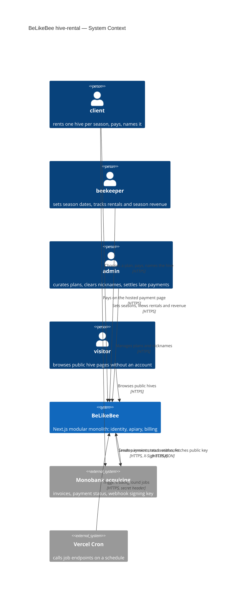
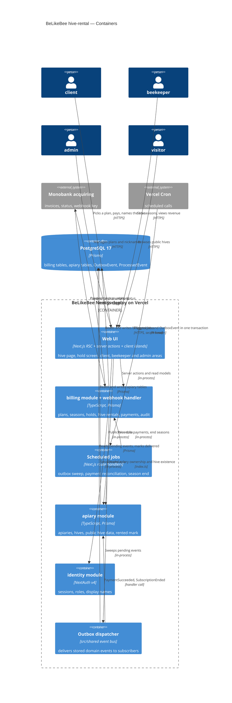
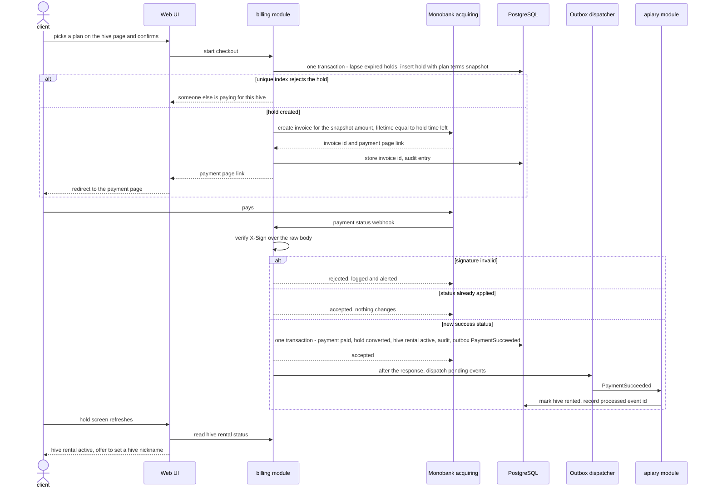
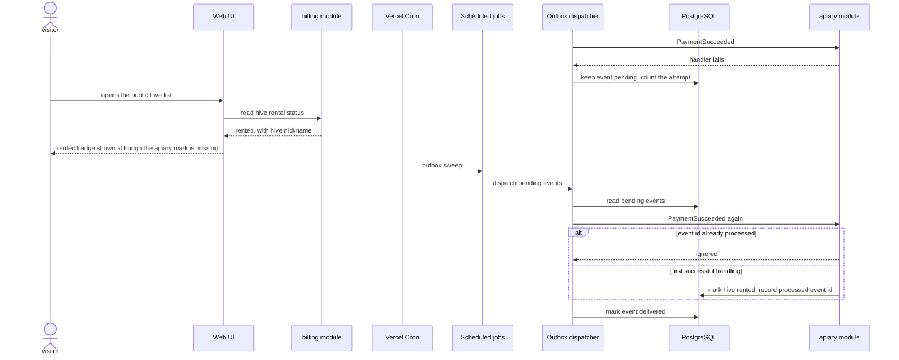
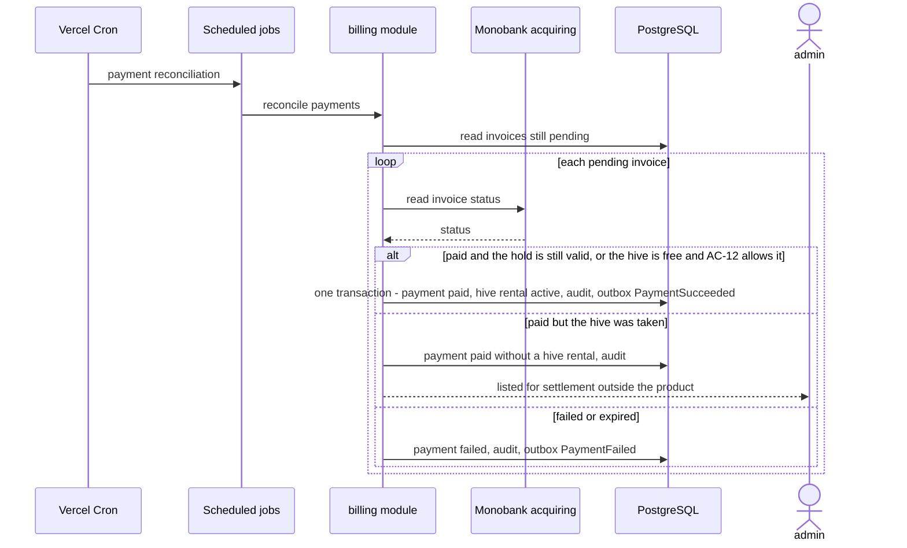

# Software Architecture Document — hive-rental

<!-- Stages 04-05 → see sdlc/plugin/skills/architecture-design/SKILL.md -->
<!-- 12 Arc42 sections. Empty sections — <!-- N/A: <one-line reason> -->. -->
<!-- C4 Context (L1) lives inline in §3. C4 Container (L2) lives inline in §5. -->
<!-- §6 Runtime view seeds the primary flow(s) here; complete-sequence-diagrams (stage 06) then -->
<!--    fills §6 with every critical flow / §5 AC — no cap. -->
<!-- Numbers in §10 come VERBATIM from PRD §6 NFR — no inventing, no rounding. -->

## 1. Introduction and goals

**Intent.** hive-rental lets a client rent one specific hive for one apiary season, pay for it once online through Monobank acquiring (test mode only), and give the hive a hive nickname. A beekeeper sets the season dates of each apiary and sees which hives are rented and the apiary's season revenue; an admin curates the plan catalogue. It is the core flow later features build on (hive feed, visits, honey reservation), and it is built inside the existing modular monolith: it is the first code in the `billing` module (PRD §1, §2).

**Top-3 quality goals (1-liners; full scenarios in §10):**

1. **Payment correctness and exclusivity**: 0 duplicate rentals and 0 double-counted payments on repeated confirmations, 0 hives with more than one active rental or checkout hold under 10 concurrent attempts, 100% of payment state changes audited.
2. **Activation reliability**: payment confirmation received → hive rental active and visible ≤ 60 s p95, including when marking the hive rented in its apiary fails (AC-17).
3. **Responsiveness**: p95 ≤ 500 ms for the hive page with plans and the public hive list; p95 ≤ 2 s from a confirmed plan to the client being on the payment page.

**Stakeholders.**

| Role | Interest | Sign-off owner? |
|---|---|---|
| client | Rents and pays for one hive per season, names it, sees the hive rental in their own area | No |
| beekeeper | Sets season dates per apiary; sees rented hives, hive nicknames, client display names and season revenue | No |
| admin | Creates and archives plans; clears offensive hive nicknames; settles payments without a hive rental (AC-19b) outside the product | No |
| visitor | Browses the public hive list and sees the "rented" badge and hive nickname, never a client's personal data | No |
| Architect / Tech Lead (ivan lysakov) | SAD and ADR approval | Yes |
| PM (ivan lysakov) | Consulted on §10 quality goals and §11 risk severities | No |

<!-- Decision overrides (¶4) — populated by the Step-7 critic resolution loop, empty otherwise.       -->
<!-- Each: «Decision override: <headline> — rationale: <reason>» so downstream skills see the choice.  -->

## 2. Constraints

**Technical.**
- TypeScript `^7.0.2`; Next.js `^16.4.2` (App Router), React `^19.3.1` (`package.json`).
- Prisma `7.10.1` with `@prisma/adapter-pg`, multi-file schema (`prisma.config.ts` → `src`, generator in `src/shared/db/schema.prisma`); PostgreSQL 17 (`postgres:17` in `.devcontainer/docker-compose.yaml`); migrations in `src/shared/db/migrations/`.
- NextAuth `^4.24.15` (Credentials provider, JWT sessions carrying `id` and `role`); Zod `^4.6.7` for all external input (forms, webhooks, env); next-intl `4.14.9` (uk and en); Tailwind `^4.3.3` + shadcn/ui; Vitest `^5.0.5` (unit + integration on `belikebee_test`), `@playwright/test` `^1.64.1`; pnpm `10.28.0`.
- Feature-first modular monolith (ADR-0001, `ARCHITECTURE.md`): cross-module calls only through `src/modules/<name>/index.ts` or domain events in `src/shared/events/`; each Prisma model is owned by one module.
- Monobank acquiring is the only payment gateway, called only from `billing` (ADR-0001 §4, `.claude/rules/billing.md`).
- The existing event bus (`src/shared/event-bus.ts`) is in-process and not durable; ADR-0001 requires a durable path for payment events before going live. No subscriber is wired yet.
- IDs are `cuid()` strings; money is integer kopecks end to end (`.claude/rules/billing.md`); no scheduler or background-job infrastructure exists.
- **Hosting: Vercel, for now** (serverless functions, no long-running process; matches the existing `@vercel/blob` photo storage). Cloudflare Workers (via OpenNext) was considered and may replace it, so the background-job trigger is kept replaceable → [ADR-0001](adr/0001-host-on-vercel-for-v1.md), §11.

**Organisational.**
- One developer (ivan lysakov), who is also Architect, Tech Lead and PM.
- Deadline: the capstone defence date, not yet known (PRD §8, due before `/sdlc:break-tasks`) → §11.
- Cut order if time runs short: US-10 (nickname moderation; admin clears by one-off script), then US-01 (plans created by script) (PRD §1).

**Conventions.**
- `CLAUDE.md`, `ARCHITECTURE.md`, `.claude/rules/billing.md`, `.claude/rules/apiary.md`.
- Module files are flat: `*.action.ts` (server actions), query modules, `*.schema.ts` (Zod), `access.ts`, `ui/`, `messages/{uk,en}.json`, `*.test.ts` / `*.int.test.ts`.
- Errors are returned as result unions, not thrown (`src/modules/apiary/add-hive.action.ts`); something another beekeeper owns answers exactly like something missing (`src/modules/apiary/apiaries.ts`).
- Cross-module references are plain IDs with no Prisma relation; migrations are named `YYYYMMDDHHMMSS_<module>_<description>`.

**Regulatory / external.**
- Payments in Monobank test mode only; no real money in v1 (PRD §3).
- No card data stored by the platform (SPEC §4); amounts and statuses are confidential.
- Every Monobank webhook is verified before processing: ECDSA over the raw body (`X-Sign`) with the key from `GET /api/merchant/pubkey`; no shared secret (CLAUDE.md, ADR-0001).
- Personal data is confidential: a hive rental links a named person to a payment and a place; the client's display name is shown only to the owning beekeeper; the hive nickname is public plain text (PRD §6.1).
- Security review required before release (PRD §6.1). Timestamps stored in UTC, shown and season-bounded in Europe/Kyiv; currency UAH (SPEC §4, PRD §1).

## 3. Context and scope

BeLikeBee already lists admin-verified beekeepers' hives publicly; hive-rental adds the money path. A client picks a season plan on an available hive, the hive is held for 15 minutes while they pay through Monobank, and Monobank's confirmation turns the hold into a hive rental that the client names and the public list shows as rented. Beekeepers set season dates and watch confirmed season revenue; the admin curates the plan catalogue (PRD §1, SPEC UC-1).

**External systems (in / out):**

| Actor or system | Type | Interaction |
|---|---|---|
| client | Person | Chooses a plan on a hive page, pays, sees the hive rental in their own area, sets the hive nickname |
| beekeeper | Person | Sets apiary season dates; sees rented hives and season revenue; clears a hive nickname on own hives |
| admin | Person | Creates and archives plans; clears hive nicknames; sees payments without a hive rental (AC-19b) |
| visitor | Person | Browses the public hive list and hive pages ("rented" badge, hive nickname) |
| Monobank acquiring | System (external) | Out: create invoice, read invoice status, fetch the webhook public key. In: payment status webhooks, untrusted until `X-Sign` is verified |
| Scheduler (Vercel Cron, per ADR-0001) | System (external) | In: calls protected job endpoints on a schedule, untrusted until its secret is checked |

Trust boundary: everything that arrives from Monobank or the scheduler is verified before the system acts on it; client input never sets an amount (PRD §6.1, price tampering).

**C4 Context (L1):**



## 4. Solution strategy

**Target surface(s) (the first decision — what's being built):** `[backend-service, web-frontend, worker]` → [ADR-0002](adr/0002-build-backend-web-and-worker-surfaces.md)

- `backend-service`: `billing` module logic (plans, seasons, checkout holds, subscriptions = hive rentals, payments, audit), server actions for every command, and the Monobank webhook route handler, all inside the existing Next.js deploy.
- `web-frontend`: hive page with plans, checkout-hold screen, client area (hive rental, hive nickname), beekeeper area (season dates, rentals, season revenue), admin plan catalogue and nickname clearing, "rented" badge on the public list. Built from the existing shadcn/ui primitives (`src/shared/ui`) and the tokens in `src/app/globals.css`.
- `worker`: scheduled route handlers called by Vercel Cron: outbox sweep (re-dispatch undelivered events), Monobank invoice reconciliation (missed webhooks), season-end job. Same deploy, no new server.

**Top strategic choices (the seeds for ADRs):**

1. **UI-architecture (web-frontend): server-rendered pages + server actions + two client islands** → [ADR-0003](adr/0003-render-rental-ui-on-server-with-client-islands.md). Pages stay React Server Components and commands go through server actions, as in `apiary`. Only the hold countdown and the payment-status block are `"use client"`; the status block calls `router.refresh()` every few seconds until the payment status is final. Serves QG-3 (p95 ≤ 500 ms) and WCAG 2.1 AA with little browser JS; no JSON API is written for the UI.
2. **`billing` owns seasons, checkout holds, subscriptions (hive rentals), hive nicknames, plans and payments** → [ADR-0004](adr/0004-billing-owns-seasons-holds-and-hive-rentals.md). Closes PRD §8 "which context owns season dates". `billing` is the source of truth for whether a hive is available, awaiting payment or rented; `src/app` pages compose `apiary`'s public hive data with `billing`'s rental status. `billing` checks apiary ownership through `apiary/index.ts`. `apiary` keeps only its own rented mark, set and cleared by events, and never reads payment state (`.claude/rules/apiary.md`). Serves QG-1 and QG-2: exclusivity and the badge never depend on the apiary mark (AC-17).
3. **Domain events go through a transactional outbox** → [ADR-0005](adr/0005-deliver-domain-events-through-transactional-outbox.md). Publishing writes an `OutboxEvent` row in the same database transaction as the state change; after the response (`after()`), a dispatcher hands pending rows to subscribers; the worker's sweep re-dispatches anything left. Delivery is at-least-once, so every handler is idempotent (a processed-event record per consumer). Closes the ADR 0001 (initial setup) risk of losing payment events and the PRD §8 "how the apiary's rented mark catches up". Serves QG-2.
4. **Hive exclusivity is enforced by the database** → [ADR-0006](adr/0006-enforce-hive-exclusivity-with-partial-unique-indexes.md). One transaction per checkout start: lapse expired holds, then insert the new hold. Partial unique indexes (unique only over rows in a given status) allow one live claim (held or active) per hive and season and one held hold per client; AC-12's overlapping-season rule runs under a per-client transaction-scoped advisory lock (`pg_advisory_xact_lock`). A second concurrent insert fails in Postgres, and client B is told someone else is paying. Serves QG-1 (10 concurrent attempts → 0 double claims).
5. **Season end is a new `SubscriptionEnded` event** → [ADR-0007](adr/0007-end-hive-rentals-with-subscription-ended-event.md). Closes PRD §8 "which signal clears the rented state at season end". Read-side status is computed from the season end date in Europe/Kyiv, so AC-26 holds at 00:00 without waiting for a job. A daily worker job then marks ended subscriptions `ENDED` and publishes `SubscriptionEnded` through the outbox, and `apiary` clears its mark on it. This needs an amendment to `.claude/rules/apiary.md` (clear on `SubscriptionSuspended` or `SubscriptionEnded`), `docs/bc-map.md` and `src/shared/events/`.

Inline (below the ADR threshold): a hold lapses by time (`expiresAt` compared at read and write), with no job; checkout holds snapshot the plan's season price and honey quota when they start (AC-05, AC-10, price tampering); the Monobank invoice is created with a lifetime equal to the hold's remaining time (PRD §8 open question, first build slice).

Each tactical decision in later sections should be traceable to one of these strategic seeds. Tactical decisions that *contradict* a strategic choice are red flags — surface them in §11 Risks.

## 5. Building block view

The feature stays inside the feature-first modular monolith (ADR 0001 initial setup): `billing` gets its first code and owns every new table (ADR-0004); `apiary` gains a rented mark and event handlers; `identity` is only read through `getSession`. Modules talk through `index.ts` calls (reads: ownership, public hive data, display names) and through outbox-backed domain events (state changes: `PaymentSucceeded`, `SubscriptionEnded`). Files follow the repo's flat module convention (`*.action.ts`, query modules, `*.schema.ts`, `access.ts`, `ui/`, `messages/`), with the Monobank adapter in its own folder behind a gateway interface (ADR 0001 initial setup §4).

**Internal decomposition:**

```
src/modules/billing/
├── billing.prisma            Plan, Season, CheckoutHold, Subscription (hive rental + hive nickname), Payment, PaymentAuditEntry
├── index.ts                  public API: server actions, read models, UI, event handlers, job entry points, messages
├── access.ts                 currentClient / currentAdmin (role checks over identity.getSession)
├── plans.ts                  plan catalogue queries
├── create-plan.action.ts     archive-plan.action.ts      plan.schema.ts
├── seasons.ts                set-season.action.ts        season.schema.ts   (ownership via apiary/index.ts)
├── checkout.ts               start-checkout.action.ts    (hold transaction, ADR-0006; invoice creation)
├── payments.ts               apply a Monobank status change once, audit it, activate or record "paid without a hive rental" (AC-19b)
├── webhook.ts                handleMonobankWebhook: X-Sign check on the raw body, then payments.ts
├── rentals.ts                read models: hive rental status per hive, client's rental, beekeeper season revenue
├── set-nickname.action.ts    clear-nickname.action.ts    nickname.schema.ts
├── jobs.ts                   reconcilePayments, endFinishedSeasons
├── monobank/
│   ├── gateway.ts            PaymentGateway interface
│   └── monobank-gateway.ts   invoice create / status / pubkey + ECDSA verify
├── ui/                       plan picker, hold screen islands, client rental card, season form, revenue table, admin plans
└── messages/{uk,en}.json

src/modules/apiary/           + rented mark on Hive; rental-events.ts (PaymentSucceeded → mark, SubscriptionEnded / SubscriptionSuspended → clear)
src/shared/db/outbox.prisma   OutboxEvent, ProcessedEvent (infrastructure, no business meaning)
src/shared/event-bus.ts       publish(tx, event) writes OutboxEvent; dispatchPending() delivers to subscribers
src/shared/events/index.ts    + PaymentSucceeded, PaymentFailed, SubscriptionActivated, SubscriptionEnded, …
src/app/event-subscriptions.ts  wires module handlers to event types (src/shared cannot import modules)
src/app/api/billing/monobank/webhook/route.ts   thin: raw body → billing.handleMonobankWebhook
src/app/api/jobs/{outbox,reconcile-payments,season-end}/route.ts   thin, cron-secret checked
src/app/…                     hive page with plans, checkout hold page, client area, beekeeper area, admin plans
```

**C4 Container (L2):**



## 6. Runtime view

Participants are the §5 containers. Messages are semantic; endpoint-level detail arrives with api-forge. complete-sequence-diagrams (stage 06) extends this section to every critical flow and §5 acceptance criterion.

**Critical flow 1: checkout hold, payment and activation (AC-10, AC-15, AC-16, AC-17)**



**Critical flow 2: apiary update fails and catches up (AC-17)**



**Critical flow 3: missed or late payment confirmation (SPEC §4 recovery, AC-19, AC-19b)**



The same apply-once logic runs for a webhook that arrives after its hold lapsed, so a late confirmation and a reconciled one end in the same state.

## 7. Deployment view

One Next.js deploy on Vercel (ADR-0001) runs pages, server actions, the Monobank webhook and the three job endpoints as serverless functions; there is no long-running process. PostgreSQL 17 is a managed instance reached through `@prisma/adapter-pg` (provider not chosen yet, §11). Vercel Cron (Hobby plan) calls each job once a day as a backstop: outbox sweep, payment reconciliation, and season end shortly after 00:00 Europe/Kyiv. The fast path does not wait for cron: the webhook activates the hive rental and dispatches the outbox after the response, and every refresh of the checkout-hold screen dispatches pending events and, if no webhook has arrived about 20 s after payment started, reads the invoice status from Monobank and applies it through the same apply-once logic (flow 3). Hold expiry and the "rented" badge are computed at read time, so they need no job.

**Monitoring:**
- Structured JSON logs with a request ID on every server action, webhook and job call (SPEC §4); webhook and job logs carry `invoiceId` / `holdId` / `eventId`.
- Alert-level log entries for: a webhook with an invalid `X-Sign`; an outbox event still pending after 5 attempts; a payment recorded as paid without a hive rental (AC-19b); a job run that fails. The alert channel is not chosen yet (§11).
- Timing: checkout start → payment link returned, and webhook received → hive rental active, logged per request for the PRD §6 latency and activation-delay measurements.

**Scaling thresholds:**
- v1 targets 10 paid hive rentals and 5 beekeepers before the first season (PRD §7): every billing table stays in the hundreds of rows; no partitioning, caching or read replica.
- The daily cron is the limit: before real money (PRD §3), or if a missed webhook ever leaves a paid client waiting more than a day, move the outbox sweep and payment reconciliation to an every-minute schedule (Vercel Pro or an equivalent scheduler) (§11).

## 8. Crosscutting concepts

| Concept | Convention | Where defined |
|---|---|---|
| Logging | Structured JSON lines to stdout through a small `src/shared/log.ts` (no new dependency): `level`, `msg`, `requestId`, `module`, plus `invoiceId` / `holdId` / `eventId` where relevant; `alert: true` marks entries that need attention (§7) | here; SPEC §4 |
| Authentication | NextAuth v4 JWT session read with `identity.getSession()`; roles `CLIENT` / `BEEKEEPER` / `ADMIN`; verified beekeeper through `apiary.currentBeekeeper()` | `src/modules/identity/auth.ts`, `src/modules/apiary/access.ts` |
| Authorization | Checked in every server action and route handler (SPEC §4) through `billing/access.ts`; anything owned by another beekeeper or client answers exactly like a missing one (AC-08, AC-22, AC-25, AC-28); only clients start a checkout (AC-14) | `src/modules/apiary/apiaries.ts`; PRD §6.1 |
| Error handling | Server actions return result unions, not exceptions; a unique-index violation on a hold maps to "someone else is paying" (ADR-0006) | `src/modules/apiary/add-hive.action.ts` |
| Input validation | Zod on every form, the webhook body (after signature check) and env vars | ADR 0001 (initial setup) §5 |
| ID strategy | `cuid()` string IDs; cross-module references are plain IDs with no Prisma relation (`hiveId`, `apiaryId`, `clientId`) | `src/modules/apiary/apiary.prisma`, `.claude/rules/billing.md` |
| Money | Integer kopecks (`Int`) end to end, UAH; the charged amount comes from the hold's plan-terms snapshot, never from the client | `.claude/rules/billing.md`; PRD §6.1 |
| Time | Timestamps stored in UTC; season start and end are dates read in Europe/Kyiv: a season runs from 00:00 on its start date to 00:00 after its end date; hold expiry is `startedAt + 15 min`, not reset by retries | SPEC §4; PRD §1 clarify decisions |
| Idempotency | A Monobank status change is applied once per invoice and status (stored applied status + `modifiedDate`); each event consumer records processed event IDs (ADR-0005) | `.claude/rules/billing.md`; here |
| Audit | One `PaymentAuditEntry` per payment state change, in the same transaction as the change (100% audited, PRD §6) | here |
| Webhook trust | `X-Sign` ECDSA verified over the raw body with the key from `GET /api/merchant/pubkey`, cached and refetched once on verification failure; invalid → rejected, logged with `alert: true` | CLAUDE.md, ADR 0001 (initial setup) |
| Job trust | Job endpoints accept only the cron secret in the `Authorization` header | here |
| Domain events | Written to the outbox in the state change's transaction; delivered at least once; handlers wired in `src/app/event-subscriptions.ts` | ADR-0005 |
| Internationalisation | next-intl, uk and en; a `billing` messages namespace; amounts formatted as UAH, dates in Europe/Kyiv | `src/app/i18n/messages.ts` |
| Privacy | Public pages show the hive nickname as plain text (1–40 characters) and never client name, email or phone; the client's display name is shown only to the beekeeper who owns the hive | PRD §6.1 |
| UI foundation | Screens composed from `src/shared/ui` primitives and `globals.css` tokens; new primitives added through shadcn, no raw colors or text sizes in markup (enforced by a PreToolUse hook) | `docs/design/design-system.md`, CLAUDE.md |

## 9. Architecture decisions

<!-- 🎯 Навіщо: ЗВОРОТНИЙ ІНДЕКС на папку adr/. `ls adr/` дає файли, §9 дає семантику —    -->
<!--           чому вони існують, до якого зрізу SAD привʼязані, у якому статусі.           -->
<!-- 📋 Що писати: таблиця з 4 колонками. Один рядок на ADR. Mixed status — це OK.         -->
<!-- 📌 Приклад: «0001 | Зберігати урок як таблицю блоків | Accepted | §4».                -->

| # | Title | Status | Section |
|---|---|---|---|
| <NNNN> | <imperative — e.g. "Use sliding window for rate limiting"> | Accepted | §<N> |
| <NNNN> | <imperative — e.g. "Co-locate outbox worker in API process"> | Accepted | §<N> |

ADR files live under `docs/features/<slug>/adr/NNNN-<title>.md`.

## 10. Quality requirements

<!-- 🎯 Навіщо: ДЕРЕВО ЯКОСТЕЙ (Quality Tree) — беремо мету з §1 і розкладаємо на          -->
<!--           конкретні листя: тести, метрики, конфіги, drill-и. ⭐ Без §10 §1 — це       -->
<!--           маніфест. З §10 кожна декларація мапиться на щось, ЩО МОЖНА ДОВЕСТИ.        -->
<!-- 📋 Що писати: на кожну якість з §1 — When / Then / How verify. Числа з PRD §6 NFR     -->
<!--           ДОСЛІВНО (не округлюй p95 ≤250мс до ≤300мс — це F6-помилка критика).        -->
<!-- 📌 Приклад: «p95 ≤500 мс на UPDATE блоку, перевіримо k6 load test 100 req/s».        -->

Each top-3 goal from §1 expanded into a full scenario:

**QG-1. <quality attribute>**
- **When:** <trigger condition>
- **Then:** <expected behavior with numbers from PRD NFR>
- **How verify:** <test / chaos drill / load test / observability>

**QG-2. <quality attribute>**
- **When:** <trigger>
- **Then:** <expected>
- **How verify:** <how>

**QG-3. <quality attribute>**
- **When:** <trigger>
- **Then:** <expected>
- **How verify:** <how>

## 11. Risks and technical debt

<!-- 🎯 Навіщо: ⭐ збирає ВСЕ, що може зламатись — і не лише технічне. Без §11 ризики   -->
<!--           обговорюються на стендапах і губляться; борг лишається у голові того,    -->
<!--           хто його прийняв.                                                          -->
<!-- 📋 Що писати: таблиця ризик/борг — серйозність — мітигація — власник. Технічний    -->
<!--           борг окремою секцією.                                                      -->
<!-- 📌 Приклад: «EM не пушить — member не оновлює дані | High | …». Перший ризик —      -->
<!--           часто продуктовий, не технічний. Це нормально.                            -->

<!-- Severity column literals: Low / Medium / High for regular risks; "Open question" for rows
     created by Step-7 `Save as Open Question` resolutions (see references/socratic-loop.md). -->

| Risk / debt | Severity | Mitigation | Owner |
|---|---|---|---|
| <e.g. Outbox lag may reach hours during downstream outage> | Medium | <Alert >10 min, on-call playbook, retry backoff> | <DevOps> |
| <e.g. No event schema versioning in v1> | Medium | <ADR-NNNN planned for v2, graceful handling of unknown fields> | <Backend> |
| Open architectural decision: <decision-headline> | Open question | Resolve before <stage trigger or YYYY-MM-DD>; <inline rationale from Step-7 Save-as-OQ> | <owner> |

**Accepted debt (acceptable in v1, plan to fix later):**
- <e.g. Goal entity is not versioned (immutable) — OK for v1, may need audit versioning in v2>

## 12. Glossary

<!-- 🎯 Навіщо: ⭐ СЛОВНИК ДОМЕНУ, який припиняє суперечки через рік («checkpoint —      -->
<!--           weekly чи biweekly? Quarter — календарний чи фіскальний?»).                -->
<!-- 📋 Що писати: таблиця термін / значення. Бізнес-терміни + технічні вперемішку.       -->
<!--           Один термін може мати дві мови у заголовку: «Goal (Обʼєктив)».              -->
<!-- 📌 Приклад: «Lesson | урок усередині курсу, що складається з блоків (text, video)». -->

| Term | Meaning |
|---|---|
| <e.g. Goal> | <quarterly intent in statement form> |
| <e.g. KR> | <Key Result — measurable target linked to a Goal> |
| <e.g. Checkpoint> | <bi-weekly progress update on a KR> |
